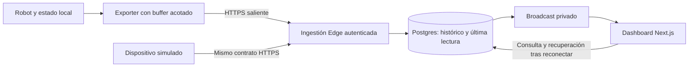

# Piloto IoT — vertical opcional posterior a la base SaaS

**Aclaración del mantenedor,2026-10-30:** el Robot pertenece a otro proyecto.
La importación Excel fue un ejemplo de vertical: validar un formato conocido,
guardar el original y trasladar registros estructurados a PostgreSQL por lote.
El código actual acepta `.xlsx` en `src/lib/robot-config.ts`; no demuestra un
importador genérico de CSV, separadores o formatos empresariales arbitrarios.
El objetivo futuro de incorporar información de una empresa con rapidez no
agrega ahora un motor de importación al núcleo. Mensajería interna y chatbot
son ideas posteriores sin alcance aprobado para este freeze. Se conserva la
implementación Robot excluida y su historia; no se integra el repositorio IoT
ni se exige reactivarlo para aceptar la base reutilizable.

**Disposición vigente 2026-10-28:** [ADR0005](../adr/0005-replicable-saas-mvp-and-bounded-acceptance.md).
Este documento conserva una propuesta e inspección históricas. Robot no es el
SaaS base ni una dependencia de015/016. Primero demostrar réplica, marca,
configuración, extensión neutral y actualización; luego decidir la vertical que
aporte al cliente. Cosmética/tarot son otros ejemplos, no implementaciones nuevas.
Las referencias siguientes a primer consumidor describen aquella propuesta,
no una obligación ni autorización actual sobre el repositorio del robot.

Fecha: 2026-09-24. Estado: dirección aportada por el mantenedor y propuesta de
acotación; no es un ADR aceptado, un plan de implementación aprobado ni una
integración ejecutada. Complementa la [estrategia de producto](product-strategy.md).

## Fuente y alcance de esta interpretación

Se leyó íntegramente el adjunto `Texto pegado.txt` (1.981 líneas), conversación
aportada por el mantenedor sobre IoT y el proyecto robot. El
[enlace compartido](https://chatgpt.com/share/6ab58f4f-a1ec-83e9-a79c-3dcd80d1be75)
no pudo recuperarse por web; el adjunto es la fuente efectivamente leída.
Las respuestas del asistente dentro del chat son propuestas, no evidencia de
implementación ni aprobación automática de cada detalle.

El mantenedor eligió la senda **Devices → Metrics → Telemetry → Dashboard**,
exploró HTTPS/Edge y aportó el robot como primer consumidor real. La conversación
evoluciona desde una consola para robots hacia telemetría reutilizable para
dispositivos. Media, MQTT y comandos aparecen como posibilidades posteriores.

Después de interpretar el chat, el mantenedor autorizó inspeccionar
`C:\_PROYECTOS_DOCKERS\omnibotpipec\server`. Se leyó código de servidor y,
selectivamente, el cliente HTTP de `robot/src` para comprobar qué datos cruzan
el contrato. Baseline observado: `993ff4b5903a852231067858ee3ce9096431a651`, rama
`feat/0047-speaker-calibration`, con cambios documentales ajenos preservados.
El repositorio no fue modificado y no se inició el servidor real. Hardware,
salud actual y conexión cloud siguen **[NO VERIFICADO]**. Los hallazgos siguientes
son de código estático; la revisión posterior de chat también incluye 43
pruebas enfocadas con dobles de prueba, documentadas más abajo.

## Tres responsabilidades, una prueba de reutilización

| Capa                  | Responsabilidad                                                                                        | Lo que no absorbe                                                |
| --------------------- | ------------------------------------------------------------------------------------------------------ | ---------------------------------------------------------------- |
| Núcleo SaaS           | Acceso humano, cuentas, membresías, permisos, marca, servicios y contratos comunes                     | Sensores, métricas, buffers del robot ni modelos cognitivos      |
| Producto IoT derivado | Dispositivos, credenciales, definiciones de métricas, ingestión, histórico, última lectura y dashboard | Memoria, personalidad, navegación física o control motor         |
| Robot y exporter      | Leer estado autorizado y exportarlo sin bloquear la operación local                                    | Gestión de usuarios SaaS ni secretos administrativos de Supabase |

El robot aporta el primer caso de uso; la vertical debe poder recibir también
un dispositivo simulado que desconozca WorldState. Esto prueba que su contrato
es IoT y no una serialización accidental del dominio del robot. No exige
construir un segundo producto ni un framework de plugins.

La relación dispositivo/cliente reutiliza `account_id` del core. No crear otro
modelo de organizaciones para traducir los nombres conceptuales del chat.
Sitios, distribuidores, jerarquías de clientes y white-label avanzado requieren
necesidades y diseño propios; no entran por aparecer en un diagrama exploratorio.

## Recorrido objetivo



La propuesta mantiene al robot operativo sin nube y exporta únicamente
telemetría permitida. No abre FastAPI doméstico a Internet. La ingestión breve
puede encajar en Edge, pero requiere medir CPU, tamaño de lote y latencia contra
los [límites actuales](https://supabase.com/docs/guides/functions/limits).
No se añade un broker para el primer recorrido.

Next.js conserva responsabilidades de servidor del SaaS; «Vercel es solo web»
no describe el árbol actual, que incluye acciones y workers Node. Elegir Edge
para ingestión IoT no migra billing ni contradice
[ADR 0003](../adr/0003-mercadopago-reliability-boundaries.md).

## Lo que se reutiliza y lo que falta diseñar

La auditoría de la base sigue siendo la
[investigación de reutilización](../audits/2026-09-24-reusable-saas-readiness.md).
En esta pasada se verificó además `src/lib/api-keys/index.ts`: su resultado de
autenticación contiene `accountId`, no una identidad ni permisos de dispositivo.
`src/app/api/v1/account/route.ts` usa un cliente administrativo y restringe la
consulta explícitamente por esa cuenta. Es un patrón de referencia, no un
servicio de provisioning IoT ya implementado ni un módulo directamente portable
a Deno sin revisar sus dependencias.

| Necesidad del piloto           | Base aprovechable                                     | Trabajo propio de la vertical                                                |
| ------------------------------ | ----------------------------------------------------- | ---------------------------------------------------------------------------- |
| Ver y administrar dispositivos | Sesión, cuenta activa, RBAC/RLS y navegación          | Entidad Device, pertenencia, reglas de creación/revocación y matriz de roles |
| Identificar al emisor          | Patrón de hash/verificación de API keys               | Credencial por dispositivo con alcance limitado, rotación y revocación       |
| Recibir medidas                | Edge/Postgres como servicios y patrones de validación | Contrato versionado, ingestión, deduplicación, unidades y límites            |
| Mostrar datos                  | Componentes de dashboard y patrones Realtime          | Histórico paginado, última lectura, antigüedad y autorización de canales     |
| Operar con coste acotado       | Logging, observabilidad y jobs existentes             | Retención, consumo de ingestión y pruebas de desconexión/recuperación        |

El módulo `robot` presente en el boilerplate importa configuración XLSX; no
demuestra este circuito de telemetría. Plan 014 corrige su superficie actual,
pero no convierte ese ejemplo en la futura plataforma IoT. En `server/src` y
`robot/src` no se encontró consumo de esas tablas/archivos Supabase. No tratar
rutinas/contactos/recuerdos del Excel como configuración sincronizada del
robot ni migrarlos automáticamente al nuevo producto.

## Evidencia del robot para escoger los primeros paneles

Rutas de esta tabla relativas a `omnibotpipec/`. «Disponible en código» no
significa que exista una serie histórica, exporter o API cloud.

| Dato o capacidad               | Evidencia de código                                                                      | Uso propuesto y límite                                                                                       |
| ------------------------------ | ---------------------------------------------------------------------------------------- | ------------------------------------------------------------------------------------------------------------ |
| Proceso responde               | `server/src/server/routers/system.py`: `/health`                                         | Indicador de última comprobación local exportada; no certifica modelos ni sensores                           |
| Recursos locales preparados    | Mismo archivo: `/ready`, STT/TTS, lifespan y DB si memoria está habilitada               | Estado preparado/no preparado; no comprueba inferencia real de Ollama ni salud de cámara                     |
| Latencias clásicas             | `schemas.py:TranscribeResponse`, `routers/transcribe.py`, `pipeline.py`                  | Series de `stt_ms`, `tts_ms`, `total_ms`; revisar significado de `llm_ms` por ruta                           |
| Latencias de streaming         | `schemas_streaming.py:StreamDoneEvent`, `streaming_render.py`                            | Comparación temporal separada por modo; `llm_ms` es residual calculado, no inferencia aislada                |
| Resultado terminal del stream  | `schemas_streaming.py:StreamErrorEvent`; `robot/src/robot/app_streaming.py`              | Conteos de completados/fallidos y códigos permitidos, tras implementar captura/exportación                   |
| Tiempo hasta primer audio      | `streaming_render.py:StreamState` y `_log_stream_metrics`                                | Existe en logs internos; no forma parte de `StreamDoneEvent` ni equivale a sonido oído por el usuario        |
| Modelos y versión configurados | `settings.py`, `main.py`                                                                 | Una ficha técnica necesita una proyección explícita de campos permitidos; no exportar configuración completa |
| Sensores físicos               | `schemas.py:SensorReading`                                                               | Solo se encontró la definición en el código examinado; no hay ruta/collector comprobado para poblar gráficos |
| Exporter cloud                 | Búsqueda acotada de `TelemetryExporter`, `telemetry`, `supabase` en ambos árboles fuente | No se encontró integración; deberá implementarse como trabajo propio con pruebas                             |
| WorldState/mapa del entorno    | Documentación `current-state.md` y modelos inspeccionados                                | No hay un WorldState situado implementado que pueda representarse como un mapa operativo                     |

Un detalle de integración: el servidor devuelve tiempos adicionales en la
respuesta clásica, pero `robot/src/robot/server_client.py:TranscribeResult`
no los conserva. El cliente streaming sí modela los tiempos en `DoneEvent`.
Elegir el punto de captura requiere resolver esa diferencia; leer el esquema
del servidor no prueba que el exporter del cliente disponga de todos sus campos.

El primer perfil de dashboard será **rendimiento del runtime**, con series de
latencia por turno y estados periódicos de disponibilidad. Estas son dos
frecuencias distintas: no generar turnos artificiales cada minuto para producir
mediciones. Una comprobación de estado tampoco exige hacer inferencia de prueba.
Temperatura, batería, CPU y otros sensores se añadirán al disponer de collectors
reales, sin mostrar valores simulados como si pertenecieran al robot.

## Cómo se incorporaría la vertical al dashboard

### Situación del SaaS comprobada

- `src/config/app.config.ts` contiene flags estáticos; `robot=false` oculta
  navegación. No existe un editor de menús para el usuario.
- `src/components/layout/app-sidebar-client.tsx` construye `navItems` dentro
  del componente. El menú móvil reutiliza este sidebar.
- `src/components/layout/app-topbar-client.tsx` mantiene otro mapa de títulos,
  una excepción para robot y atajos de teclado con rutas propias.
- `src/app/[locale]/dashboard/page.tsx` define sus propios accesos rápidos.
  Consulta proyectos aunque su enlace esté oculto por configuración.
- Hay Card, Table, Tabs, Badge y estados de carga como piezas visuales. No se
  encontró componente `chart` en `src/components/ui` ni dependencia de gráficos
  declarada en `package.json`. El home actual muestra accesos rápidos.

Por tanto, añadir una vertical requiere hoy coordinar varios archivos. El
problema compartido a resolver es la composición de navegación y del inicio.
Agregar una bandera aislada dejaría esa duplicación intacta.

### Contrato de composición propuesto

Un catálogo TypeScript pequeño y versionado declarará por módulo su ID, rutas,
claves de traducción, icono, orden/grupo, disponibilidad, visibilidad por rol,
acceso de inicio y capacidades requeridas. Sidebar, títulos, accesos y atajos
consumirán esa fuente. Las rutas Next.js y los componentes continúan siendo
código explícito; el catálogo no genera endpoints ni concede permisos.

La configuración inicial la hace el desarrollador del producto. El usuario
final configura sus dispositivos y filtros. Permitirle construir dashboards,
ejecutar consultas o instalar plugins sería otro alcance. No almacenar SQL,
JavaScript o URLs de consulta arbitrarias como configuración de un widget.

Cada panel declara una consulta tipada, unidad, ventana temporal, agregación,
capacidad requerida, permiso y estados vacío/error/atrasado. El núcleo aporta
contenedores y patrones; la vertical define el significado de sus datos.
Definir tres presentaciones iniciales: indicador, serie temporal y tabla de
eventos. Seleccionar el renderer de gráficos al implementar, respetando el
[sistema de diseño](../design-system/README.md) y sin instalar dependencias en
esta investigación.

La capacidad de medir algo es distinta de la autorización para verlo. La lista
de métricas admitidas debe quedar validada por el producto; un dispositivo no
puede habilitar pantallas o permisos enviando un nombre de capacidad.
Al cambiar cuenta/dispositivo se separan claves de caché y se cierran las
suscripciones anteriores; no mostrar durante la transición datos de otra cuenta.

### Navegación y contenido del primer producto derivado

```text
Cuenta activa
  Resumen
  Dispositivos
    Dispositivo seleccionado
      Estado
      Rendimiento
      Eventos técnicos
      Conexión y acceso
  Equipo
  Actividad de la cuenta
  Facturación (si corresponde)
  Configuración
```

Los cuatro apartados del dispositivo son pestañas contextuales, no cuatro
menús globales. «Eventos técnicos» pertenece al dispositivo; «Actividad de la
cuenta» mantiene la auditoría administrativa. Las credenciales se administran
por owner/admin según la matriz que se acuerde; un viewer ve únicamente los
datos autorizados y no recibe secretos. La ausencia de dispositivos conduce a
un estado vacío con alta guiada para el rol permitido.

| Pantalla          | Qué mostraría                                                                                      | Fuente necesaria                                                                                  |
| ----------------- | -------------------------------------------------------------------------------------------------- | ------------------------------------------------------------------------------------------------- |
| Resumen           | Dispositivos registrados, última recepción y avisos de datos atrasados                             | Inventario IoT e ingestión, pendientes; no convertir silencio en diagnóstico de avería            |
| Estado            | Últimos resultados de `/health` y `/ready`, con hora de observación/recepción                      | Exporter local pendiente; distinguir fallo del probe y falta de comunicación                      |
| Rendimiento       | Serie de tiempo total, STT/TTS y residual de respuesta por modo; mediana/p95 con tamaño de muestra | Tiempos ya calculados en servidor, captura e histórico pendientes; no sumar percentiles de etapas |
| Eventos técnicos  | Completados/fallos y códigos controlados, filtrables por intervalo                                 | Contrato de evento saneado; no subir logs crudos, textos, audios o identificadores personales     |
| Conexión y acceso | Identificador, estado de credencial, revocación/rotación y ejemplo de envío                        | Provisioning del piloto, pendiente; el secreto solo se entrega en el flujo autorizado             |

Cada gráfica diferencia «sin observaciones», cero real, fallo de consulta y
datos atrasados. Un panel solo se muestra cuando su perfil/capacidad lo permite;
la serie permanece vacía si todavía no hay muestras. No mezclar bajo una misma
etiqueta latencias clásicas, residuales de streaming y tiempos de reproducción.

El Excel existente se conserva como demostración histórica mientras Plan 014
resuelve sus permisos. Su eventual retirada o migración debe decidirse de forma
explícita; este diseño no borra datos ni lo conecta a memoria privada del robot.

## Chat con el agente — evaluación del componente existente

El mantenedor planteó conversar con el agente desde el dashboard. El servidor
ya tiene una interfaz local `/chat-ui/`, montada por `chat_ui.py`, que llama a
`POST /chat` en `routers/chat.py`. Reutiliza `CognitiveController` y
`process_text_turn`; no es necesario crear otra personalidad ni otro backend
LLM para añadir un canal web.

La implementación está bien acotada como **diagnóstico local de texto**:

- `schemas_chat.py` limita mensaje/conversation_id y rechaza campos extra,
  incluida identidad o consentimiento enviados en el JSON del cliente.
- La ruta usa el controlador, autorización y respuestas deterministas
  existentes; no invoca STT/TTS y declara que carece de cámara.
- La UI renderiza mediante `textContent`, mantiene política de mismo origen,
  valida respuestas y bloquea envíos mientras espera una respuesta.
- Hay pruebas específicas de contrato, entradas inválidas, rechazo de acceso
  privado, separación de audio y ausencia de memoria para interlocutor desconocido.

### Límites que impiden considerarlo chat SaaS aceptado

1. **Continuidad.** `chat.js` envía solo mensaje y conversation_id; no envía el
   token opcional de propietario. En `text_turn.py`, el camino público usa un
   scope interno por turno, omite historia/retrieval y descarta memoria de
   trabajo. Mantener el mismo conversation_id o las burbujas en pantalla no
   proporciona contexto al modelo. Esto está probado intencionalmente en
   `test_chat_without_internal_evidence_is_one_turn_and_stateless`.
2. **Identidad y permisos.** La ruta soporta un grant local de un uso para
   determinados casos autorizados, pero la UI no lo integra. Tampoco existe
   vinculación Supabase usuario/cuenta → agente → capacidades concedidas.
   El callback genérico llama a `process_text_turn` sin pasar el actor resuelto;
   por tanto añadir un token por sí solo no resuelve la continuidad genérica.
   Una sesión conversacional aislada puede tener contexto temporal sin recibir
   permiso sobre la memoria doméstica: son contratos separados.
3. **Experiencia.** No hay streaming de texto, cancelación/timeout explícito
   en cliente, reintento por mensaje ni historial recuperable. `sessionStorage`
   guarda el ID; el transcript vive en el DOM y desaparece al recargar. El
   streaming de audio `/transcribe/stream` es otro contrato, no un endpoint de
   streaming de texto listo para reutilizar sin diseño.
4. **Estado del resultado.** `TextTurnResult.llm_failed` se convierte en texto
   de fallback y el contrato `ChatResponse` no expone un estado tipado de
   degradación. Un `200` no distingue por sí mismo respuesta del agente y
   fallback. La UI remota necesita distinguir agente no disponible, timeout,
   denegación, error y respuesta completada sin revelar excepciones privadas.
5. **Conexión remota.** Una página SaaS no tiene una conexión autorizada al
   servidor doméstico por mostrar su URL. Conversar añade solicitudes hacia el
   agente, distintas del flujo saliente de telemetría. Necesita transporte,
   asociación de cuenta/agente, expiración y deduplicación propios. No publicar
   FastAPI o reenviar `/auth/owner/unlock` como atajo para resolver esa frontera.

### Incorporación propuesta al producto

Una pestaña **Conversar** en el dispositivo/agente seleccionado puede usar el
mismo contenedor y composición del dashboard. Debe declarar capacidad chat,
agente de destino, estado de conexión y permiso de conversación. No se presenta
para cualquier sensor ni queda autorizada solo porque el usuario sea admin SaaS.

Primer alcance sugerido: texto, un agente, conversación temporal aislada,
continuidad de turnos y manejo de desconexión. Historial persistente requiere
decidir retención, borrado y quién puede leerlo; no activarlo por comodidad.
El acceso a datos personales o acciones del robot conserva permisos propios.
Tener gráficos de telemetría tampoco da al LLM herramientas para consultarlos:
esa capacidad necesita un contrato de lectura autorizado si se incorpora.

Secuencia: definir sesión y capacidades en el robot → comprobar conversación
local con contexto y aislamiento → diseñar puente remoto → integrar UI SaaS.
El puente debe preservar operación local y vinculación explícita de agentes;
un canal iniciado hacia fuera por el conector es una opción a diseñar, no una
integración presente. Esta secuencia necesita su propio trabajo aprobado y no
bloquea el cierre del piloto de observación ni del núcleo SaaS.

### Verificación enfocada del chat

Sobre `993ff4b5903a852231067858ee3ce9096431a651`: **43 passed in 7.98s**.
Ejecutado con el Python ya instalado, sin instalar dependencias. El recipe
`just test` corre la suite completa; para esta revisión se seleccionaron
directamente los tres archivos relevantes, con logging a disco y cachés apagados:

```powershell
$env:PYTHONDONTWRITEBYTECODE = '1'
$env:LOG_TO_FILE = 'false'
$env:LOG_CONVERSATION_TEXT = 'false'
.\.venv\Scripts\python.exe -m pytest tests/integration/test_chat_endpoint.py tests/integration/test_chat_ui.py tests/unit/test_text_turn.py -q -n0 -p no:cacheprovider -o log_cli=false
```

Los tests de endpoint usan ASGI y dobles de generación, sin cargar los modelos.
Los de UI sirven assets y comprueban contratos del HTML/JS; no son una prueba
de interacción en navegador. No se verificó calidad de conversación con Ollama
real, sesión autenticada remota, streaming web ni acceso Cloud.

## Condiciones técnicas que el chat deja abiertas

Estas son propuestas de contrato para revisar antes de implementar:

1. **Identidad y autorización.** Credencial exclusiva por dispositivo; la
   cuenta y el dispositivo se resuelven en servidor. No aceptar un `account_id`
   del cuerpo como autoridad, ni reutilizar la clave general de cuenta como
   identidad de todos sus sensores. Nunca distribuir `service_role` o claves
   secretas de proyecto al robot. Un token opaco propio no es un JWT de usuario:
   revisar el gateway y la validación del handler según
   [autenticación Edge](https://supabase.com/docs/guides/functions/auth-headers).
   Si un cliente privilegiado escribe saltándose RLS, el aislamiento debe
   implementarse y probarse en esa ruta/RPC; tener RLS en otras tablas no lo cubre.
2. **Entrega repetible.** Identificador estable por lote generado antes de
   enviarlo, persistido para reintentos. Propuesta: unicidad por dispositivo/lote,
   misma carga repetida sin duplicados; mismo identificador con carga diferente
   produce conflicto. Definir límites del lote y rechazo atómico de entradas
   inválidas antes de fijar el JSON público.
3. **Confirmación durable.** Responder éxito de persistencia después del commit.
   Reservar `202` para aceptación durable en una cola que realmente exista; una
   tarea en memoria o un Broadcast no bastan. La cola cloud no es requisito del
   primer corte síncrono; el buffer local sí necesita capacidad y política de
   descarte explícitas para no bloquear el robot.
4. **Tiempo y estado.** Guardar `observed_at` y `received_at`; definir límites de
   reloj y atraso. Un lote antiguo no debe reemplazar una lectura más reciente.
   Mostrar «última recepción hace X», sin inferir que un robot está sano solo
   porque hubo telemetría o confundir atraso con un diagnóstico físico.
5. **Métricas y unidades.** Tipos, rangos, unidades admitidas y versión de esquema
   explícitos; rechazar valores no finitos y conversiones incompatibles. Comenzar
   con unas pocas métricas escalares disponibles, no un motor universal de
   sensores. El protocolo puede transportar la unidad de origen y la ingestión
   aplicar la conversión canónica; evitar dos normalizadores contradictorios.
6. **Realtime recuperable.** Persistir primero y derivar la publicación de ese
   resultado. El dashboard consulta Postgres al abrir/reconectar y no necesita
   recibir todos los eventos para recuperar el estado. Supabase recomienda
   [Broadcast](https://supabase.com/docs/guides/realtime/subscribing-to-database-changes),
   pero el canal privado necesita políticas y configuración; su nombre no lo
   protege. Probar también qué ocurre con una conexión ya abierta tras revocar
   una membresía: la [autorización](https://supabase.com/docs/guides/realtime/authorization)
   se calcula al conectar/unirse y no permite asumir revocación inmediata por fila.
7. **Datos exportables.** Lista permitida de métricas operativas. No enviar
   conversaciones, recuerdos, identidad de personas, biometría, audio/video o
   WorldState completo para probar un gráfico. Son otros contratos de producto
   y privacidad, no simples campos adicionales de telemetría.

## Propuesta de piloto pequeño y presupuesto medible

Propuesta inicial, aún no compromiso de capacidad: un robot, de tres a cinco
métricas realmente disponibles, lote cada 60 segundos e histórico crudo de
siete días. Empezar con emisor simulado para validar el servidor; sustituirlo
por datos reales para aceptar la integración. No inventar sensores ausentes.

Cinco métricas cada minuto producen **216.000 puntos en 30 días** y **43.200
peticiones** si viajan juntas y no hay reintentos. Siete días conservan unos
50.400 puntos estables. El tamaño depende del modelo de filas, índices y
metadatos; estos cálculos no son una prueba de capacidad ni de coste final.
Con diez métricas cada 30 segundos, un dispositivo ya produce 864.000 puntos
en 30 días. Reducir peticiones por lote no reduce por sí mismo los datos guardados.

Supabase Free anuncia 500 MB de base y 500.000 invocaciones Edge incluidas;
Realtime, transferencia y los demás módulos comparten presupuestos que deben
medirse. Consultar [precios y cuotas](https://supabase.com/pricing) antes del
ensayo, no prometer capacidad por número de dispositivos sin frecuencia,
retención y audiencia. Medir bytes, puntos aceptados/rechazados/duplicados,
peticiones y crecimiento real; no convertir esos contadores en facturación
por uso durante el piloto.

La opción [self-hosted](https://supabase.com/docs/guides/self-hosting) implica
operar, respaldar y verificar servicios; no prueba portabilidad automática del
producto. [Vercel Hobby](https://vercel.com/docs/plans/hobby) es personal/no
comercial. El presupuesto productivo se define por el servicio ofrecido, sin
asumir que todos los planes gratuitos o todas sus prestaciones son equivalentes.

## Secuencia propuesta y qué demostraría

| Paso                                   | Resultado necesario                                                                          | Evidencia de cierre                                                                                             |
| -------------------------------------- | -------------------------------------------------------------------------------------------- | --------------------------------------------------------------------------------------------------------------- |
| 0. Contrato y auditoría del emisor     | JSON v1, roles humanos/dispositivo, frecuencia, retención y punto de conexión real del robot | Contratos y archivos identificados; límites acordados; todavía sin promesa de integración                       |
| 1. Dispositivo simulado hasta Postgres | Provisioning acotado, credencial, ingestión y lectura autorizada                             | Dos cuentas aisladas; credencial revocada rechazada; duplicado sin doble inserción; datos inválidos sin efectos |
| 2. Dashboard y recuperación            | Última lectura e histórico con canales privados                                              | Recarga/reconexión conserva datos; atraso visible; viewer no administra dispositivos; revocación verificada     |
| 3. Robot real como consumidor          | Exporter no bloqueante y buffer limitado                                                     | Internet caído no detiene operación local; reenvío sin duplicados; límites de almacenamiento/CPU medidos        |
| 4. Prueba de reutilización             | Derivado configurado/extendido y actualizado                                                 | Evidencia de Plan 015, sin reimplementar cuentas/RBAC ni perder datos/personalización al actualizar             |

No se convierte este mapa en un Plan 016 con archivos supuestos antes de
inspeccionar el emisor y revisar las decisiones del paso 0. Los planes
[012](../exec-plans/active/012-security-hardening-and-pricing-truth.md) y
[014](../exec-plans/active/014-reference-surface-correctness.md) mantienen sus
correcciones; el piloto no las sustituye ni cierra billing de Plan 011.

El [Plan 015](../exec-plans/active/015-reusable-foundation-acceptance.md) puede
utilizar este dominio para su ensayo de extensión cuando se concrete, en vez
de obligar a construir además otro vertical neutral. Debe conservar sus pruebas
de instalación, permisos, archivo privado/notificación, actualización y operación;
la telemetría sola no cubre todas. Su cierre tampoco depende de terminar el robot,
MQTT, cámaras, control remoto o de vender el producto IoT.

La existencia de plataformas competidoras muestra oferta, no valida demanda
por esta combinación. El uso propio dará evidencia de utilidad y reutilización;
la disposición de terceros a pagar sigue **[NO VERIFICADO]**.
