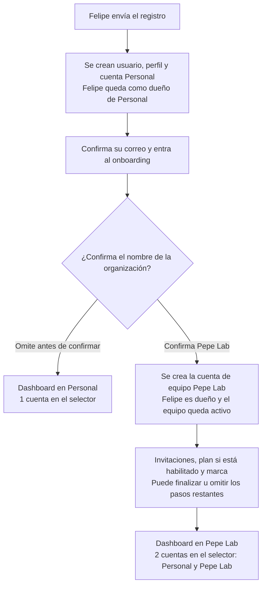
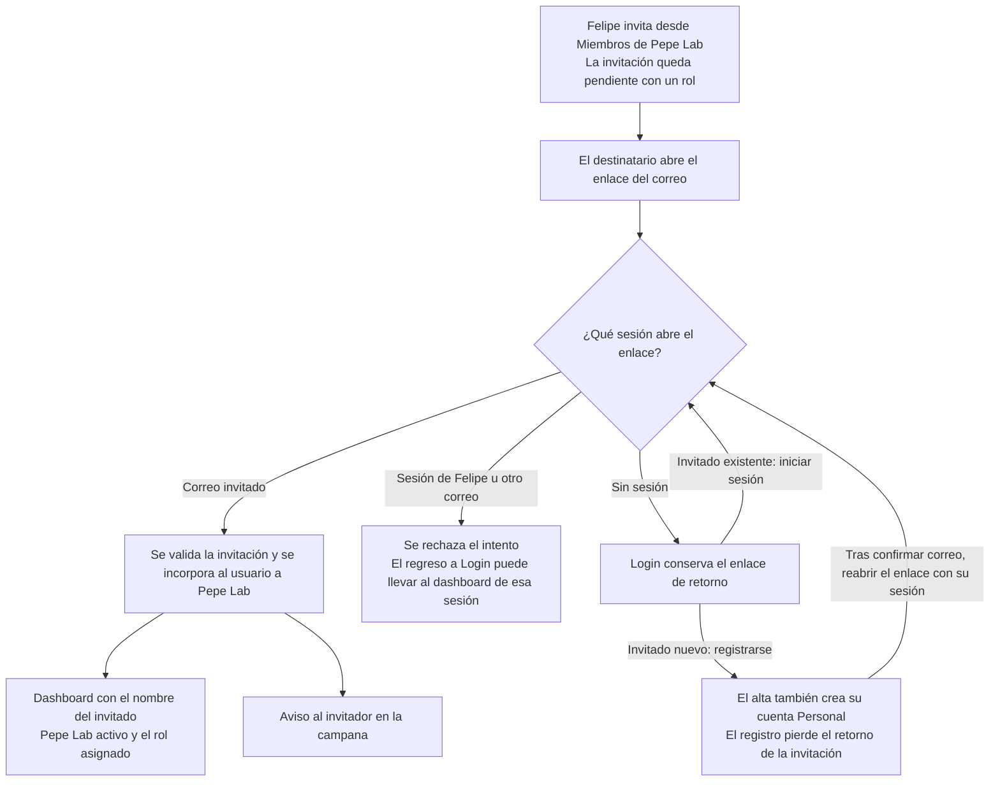

# Registro de QA humano

## Continuación local del 26-11-2026

- Base `ac1cd4b` y cambios locales en `main`. Se recuperó la documentación
  del stash `afb9c2f84b4ab1cb4f4e52f4c3a282ad7108ef62`. Sus cambios de código
  y dependencias siguen en el stash. La corrección de MFA mantiene el contrato
  estricto del ADR 0006 y actualiza los textos en ES, EN, PT y FR.
- FIX-07 envía al formulario de login o registro según la identidad de Auth.
  Si falla la consulta, el correo conserva la ruta de aceptación anterior.
  `supabase migration up --local` aplicó `20261126190000` en
  `127.0.0.1:54322`. PostgreSQL confirmó que sólo `service_role` puede
  ejecutar la consulta entre los roles expuestos y distinguió un correo
  existente en mayúsculas de uno ausente.
- Pasaron 93 pruebas focales de Vitest para MFA, acciones de Auth y equipo,
  y la ruta de aceptación antes de incorporar los ajustes de Seguridad
  y la continuación para una sesión ya autenticada.
- El harness local `node scripts/run-reconciliation-db-test.mjs` pasó
  1.235 comprobaciones en 61 archivos, incluidos MFA, invitaciones, RBAC y
  organización inicial. El formato global y las 12 pruebas de los
  verificadores de documentación y diseño también pasaron.
- Vitest completo pasó 1.792 pruebas en 157 archivos, con una omitida. La
  repetición focal posterior de Auth, MFA, ajustes y equipo pasó 145.
  El enlace mágico responde igual ante un envío y ante `otp_disabled`.
- Edge local, con fixtures propios, confirmó recuperación MFA e ingreso
  nuevo, cambio de correo con doble confirmación y nuevo login, guardado
  de campos de organización, invitaciones a cuentas nuevas y existentes
  y rechazo de sesión equivocada. Reabrir el correo conservó una única
  membresía `member`. La campana mostró la aceptación en vivo y su
  consulta tras recargar devolvió el aviso persistido.
- FIX-02 pasó con el build de producción local. Edge descargó el JSON de
  exportación antes del reset. Tras parar Next, ejecutar `supabase db reset
--local` y volver a levantarlo, Auth confirmó que el usuario de prueba
  había desaparecido. La navegación HTTP y el mismo contexto de Edge con
  sus cookies originales volvieron al login con el destino preservado.
  Un contexto limpio mostró el mismo retorno. La navegación en desarrollo
  había agotado su tiempo de espera antes de esta verificación.
- El build de Next completó TypeScript y generó 124 páginas estáticas.
  Las 14 aserciones SQL focales de invitación pasaron, incluidas caducidad
  y revocación. Cloud queda `[NO VERIFICADO]` en esta pasada.

Creado2026-11-18 para separar observaciones del propietario y validaciones
pendientes de la auditoría técnica. **No es todavía el plan global de QA ni una
aceptación del MVP.** Véase la
[propuesta de reorganización](../audits/2026-11-18-capability-audit-reorganization.md).

## Punto de partida para hoy — 2026-11-19

Esta bitácora reúne los hallazgos, la evidencia y los pendientes. Durante el
recorrido, marcar los resultados en
[Iroko · QA local en Google Sheets](https://docs.google.com/spreadsheets/d/16_eHqYwc3Ugp9SNLop35Id1Rt_LC4KXXiEK0cW8St-Q/edit).
Los archivos Excel conservan las pasadas anteriores. Para retomar, usar este
punto de partida, el [atlas de formularios](#atlas-de-formularios-y-controles--2026-11-18)
y la [cola post-QA](#cola-para-planes-después-del-qa--2026-11-18).
Para repetir pantalla por pantalla, usar la pestaña
[Dashboard por pantalla](https://docs.google.com/spreadsheets/d/16_eHqYwc3Ugp9SNLop35Id1Rt_LC4KXXiEK0cW8St-Q/edit?gid=1873201601#gid=1873201601).
Para seguir desde los resultados vigentes, ir al
[cierre funcional del dashboard](#cierre-funcional-del-dashboard--2026-11-19).

- Ya comprobado por el propietario en local: alta y confirmación, salida y
  reingreso, los nueve campos de perfil y la foto, guardado del logo, cambio
  de cuenta, cambio de contraseña, recuperación desde Seguridad y Magic Link.
  El cambio de correo se completó en Auth. El nuevo login
  y los avisos y retornos de ese flujo conservan sus pendientes. La clave API
  se creó. Falta comprobarla tras recargar y revocarla.
- El propietario confirmó Proyectos/Markdown y la plantilla Excel de Robot
  con `start` local en `127.0.0.1`. En un equipo, la invitación se creó y
  llegó por correo. La aceptación falló con la sesión del invitador. Ver
  la [pasada con el build local](#pasada-con-el-build-local--2026-11-19).
- La pasada local tiene 8 de 12 casos base aprobados, 3 con fallo observado
  y 1 sin ejecutar (Facturación). Onboarding queda fallido frente al criterio
  del espacio inicial. Los recorridos complementarios se cuentan aparte.

**Para volver a levantar el build local**, usar `pnpm build:qa` y luego
`pnpm start --hostname 127.0.0.1`, con Supabase local arriba. Para iterar
sin compilar, usar `pnpm dev --hostname 127.0.0.1`.

**Retomar la aceptación y Realtime con el usuario invitado.** QA-17 tiene
creación y correo aprobados. La aceptación y la recepción en vivo están
pendientes. Ver el [recorrido completo de invitación](#invitación-por-correo-y-contexto-de-trabajo--2026-11-19).
Los [diagramas de registro e invitación](#diagramas-del-registro-y-la-invitación)
ubican dónde se crean las cuentas y cuándo cambia el espacio activo.
Ya está documentado en el plan 016 como N-07, con evidencia de navegador
local. El caso vigente se encuentra en `src/test/e2e/qa-storage-realtime.spec.ts`.

1. Con la cuenta A, propietaria del equipo de prueba y con un cupo libre,
   abrir **Miembros → Invitar miembro**. Invitar sólo a una cuenta local B
   propia. Confirmar que llega el mensaje en Mailpit y dejar A abierta.
2. En otro contexto de navegador, iniciar sesión como B con la dirección
   invitada y abrir ese enlace de Mailpit. Si el correo apunta a
   `localhost:3000`, usar ese mismo origen para la sesión B. B debe entrar
   en el equipo.
3. Sin recargar A, abrir **Notificaciones**. Debe aparecer una notificación
   con el texto «… aceptó tu invitación». Después, recargar A y confirmar
   que permanece. Si sólo aparece tras recargar, registrar que persistió
   y que la entrega en vivo falló en esa pasada. Si faltó el correo o B no
   entró al equipo, el disparador aún no se probó.

Devolución breve: caso, resultado y paso, y para Realtime indicar «correo
recibido sí/no, B entró sí/no, campana sin recarga sí/no, tras recarga sí/no».
Usar los mismos dos usuarios para la presencia QA-18 en otro turno.

La invitación usa **React Email** para la plantilla y Mailpit como destino
de pruebas en la configuración local revisada. La **campana Realtime** se
dispara al aceptar la invitación. **Admin → Alertas** encola correo a
propietarios. **Admin → Anuncios** sí publica en la campana y tiene alcance
global, por lo que no forma parte de este turno.

## Cierre funcional del dashboard — 2026-11-19

Esta pasada evalúa qué puede hacer una persona con una sesión local normal.
La planilla «Dashboard por pantalla» conserva el estado de cada caso y
«Recorrido» conserva sus IDs. Evaluar cada resultado con el entorno, el
espacio activo y los pasos observados. Los cambios de producto se retoman
desde los hallazgos de la bitácora.

**Comprobado.** Registro y confirmación, salida y reingreso, perfil y foto,
contraseña desde Seguridad, cambio de cuenta, logo, creación y revocación
de claves API, Markdown (crear, editar,
guardar y borrar), Robot (descargar, modificar e importar), Actividad y
filtro Documento, Webhooks como vista del plan, campana y toast en vivo,
los cuatro idiomas, cambio de tema y las tres plantillas del visor de correo.
El propietario confirmó el enlace del aviso y que el punto se apaga sin
volver a mostrar el toast al recargar. En la vista lateral se corroboró
Inicio con saludo y equipo activo, Miembros con una fila activa y una
«Invitado» de rol Miembro, y los estados «Próximamente» de Seguridad de
organización, Integraciones y Eliminar organización.

**Fallos que ya tienen evidencia.** El onboarding creó un segundo espacio
donde se esperaba configurar el inicial. Ajustes → General conserva el valor
anterior hasta recargar. El intento inicial de cambiar a English desde
Actividad se conserva como antecedente. El propietario confirmó luego
que pudo cambiar a los cuatro idiomas y volver al dashboard. Con el invitador
autenticado, el enlace de invitación volvió al dashboard sin explicar el
rechazo. Esos hallazgos siguen abiertos y se pueden retomar sin repetir
todos los casos aprobados.

### Mini manual para completar la pasada

1. **Invitación y presencia (QA-17/18):** dejar abierta la sesión del dueño
   en Miembros. En otro perfil del navegador, entrar con el correo del
   invitado y abrir el link de Mailpit. Confirmar el equipo y el rol, la fila
   de miembro activo y el aviso al dueño sin recargar. Con ambos en Miembros,
   observar «En línea», y luego salir de esa pantalla en la segunda sesión.
   El correo ya llegó. Falta acreditar la aceptación con el destinatario.
2. **Perfil y sesiones:** comprobar el login con el correo nuevo tras las
   confirmaciones. Probar la identificación desde el teléfono cuando esté
   disponible. Windows ya apareció en la vista de escritorio.

Registrar `pantalla · paso · esperado · observado · estado` en la planilla.
Usar la vista lateral de Codex y guardar un pantallazo sólo cuando aporte
evidencia del resultado. El panel de Administración queda condicionado a
una sesión de plataforma con MFA. El 404 observado con el rol actual ya
está registrado.

### Mejoras para revisión de diseño

| Superficie              | Qué revisar                                                                                                                                                     | Referencia           |
| ----------------------- | --------------------------------------------------------------------------------------------------------------------------------------------------------------- | -------------------- |
| Onboarding              | Explicar qué espacio se está configurando y ordenar visualmente los precios y su periodicidad en escritorio y móvil.                                            | QA-OBS-02/05         |
| Organización            | Mostrar progreso al crear un equipo y feedback claro al guardar. El valor confirmado debe verse sin recargar cuando se corrija la actualización.                | QA-OBS-04/13         |
| Registro y Seguridad    | Unificar la presentación de reglas de contraseña, el control para mostrarla y la indicación de revisar el correo. Aclarar la opción del código de confirmación. | QA-OBS-03/06/08/09   |
| Cambio de correo        | Guiar las dos confirmaciones y el retorno a Perfil. Hacer visible qué falta y cuándo se completó.                                                               | QA-OBS-07/08/10      |
| Miembros e invitaciones | Aclarar dónde se puede invitar y qué hacer si la sesión abierta corresponde a otra persona. Dar continuidad a quien todavía debe registrarse.                   | QA-OBS-11/12         |
| Campana                 | Revisar el toast en tema claro y móvil, el foco del cierre y los avisos consecutivos. Ya hay captura aprobada en escritorio oscuro.                             | QA-OBS-15            |
| Claves API              | La revocación abre una confirmación nativa. Mostrar un diálogo de Iroko con «Cancelar» y «Revocar» y avisar el resultado después.                               | QA-OBS-16            |
| Sesiones                | Hacer comprensible el estado cuando el dispositivo no se puede identificar. Quedó una fila con la etiqueta «node».                                              | Mi cuenta → Sesiones |

**Facturación:** continuar como frente independiente con el
[Plan 011](../exec-plans/deferred/011-billing/README.md). En la vista abierta
al comenzar esta pasada se leyó «El checkout no está disponible
temporalmente». Guardar el dato para ese frente. **Home y vistas públicas:**
recorrido posterior en una sesión sin login. Ambos quedan fuera del cierre
de este bloque de dashboard. La revisión de seguridad conserva sus propios
registros.

## Observaciones y casos iniciales

| Caso       | Recorrido                                           | Estado                         | Evidencia / límite                                                                                                                                                                         | Referencia                                |
| ---------- | --------------------------------------------------- | ------------------------------ | ------------------------------------------------------------------------------------------------------------------------------------------------------------------------------------------ | ----------------------------------------- |
| QA-AUTH-01 | Login normal en Cloud                               | Informado por el propietario   | El18Nov confirmó que puede iniciar sesión desde su navegador habitual. No se registraron pasos completos ni revisión exacta; no demuestra recuperación MFA ni todos los métodos de acceso. | Entrega de acceso/cuenta                  |
| QA-AUTH-02 | Recuperación con código MFA y nueva autenticación   | Pendiente de ejecución humana  | Turnstile bloqueó el login automatizado en Actions antes de probar recuperación; conservar prueba de contenido tras recarga, sesión previa revocada, reuso denegado y limpieza de fixture. | A-ACCESS-01                               |
| QA-AUTH-03 | Recuperación de contraseña desde navegador y correo | Aprobado desde Seguridad local | El propietario completó el recorrido desde el dashboard. Demora y reintentos anotados. La entrada pública desde Login del caso QA-12 queda por comprobar.                                  | Matriz de capacidades y evidencia de Auth |

Las referencias de acceso/cuenta apuntan a la
[entrega y pruebas](../audits/2026-11-18-access-account-delivery.md) y al
[registro central de hallazgos](../exec-plans/active/freeze-remediation-register.csv).
Los IDs QA identifican escenarios, no defectos nuevos ni una segunda cola de reparación.

## Checkpoint humano — 2026-11-18

- QA-AUTH-01: **aprobado, alcance informado por el propietario**: puede iniciar
  sesión normalmente en Cloud desde su navegador habitual. Revisión y hora de
  aquella observación: [NO VERIFICADO]. No acredita recuperación MFA.
- QA-STORAGE-01: **aprobado, alcance informado por el propietario**: ha subido
  logos e imágenes que cargan en Cloud. Revisión, archivos, tamaños, formatos,
  pantalla exacta y persistencia tras recarga de aquella observación:
  [NO VERIFICADO]. No acredita límites ni todos los consumidores de Storage.
- DB-01 conserva su brecha de permisos del perfil y su disposición en el
  registro central. El recorrido funcional siguiente no la cierra.

## Turno 1 — QA-AUTH-04: cuenta nueva, confirmación y dashboard

Preparado el 2026-11-18, America/Santiago. Resultado: **no ejecutado**;
pendiente del propietario. Ejecutor: propietario, navegador humano. Rol:
visitante → usuario autenticado, propietario de su cuenta personal; sin rol
de administrador de plataforma.

Entorno: `https://project-a89lv.vercel.app/`. Checkout `main`,
`66bc3f792e1907943e84251fb5f09a632e44b787`, con documentación local previa
preservada. Consulta MCP Vercel `get_deployment` por el hostname canónico:
READY, alias presente, SHA idéntico, deployment
`dpl_CU2LtQfvg9tXEwbbhoTN4r8EuREz`. Es el candidato comprobado al preparar el
turno; confirmar de nuevo si hay otra entrega antes de ejecutarlo. La consulta
no demuestra funcionamiento del formulario ni entrega de correo. El lector web
no pudo acceder a `/es/signup`; eso no demuestra bloqueo del navegador humano.

### Inventario acotado y contrato

| Pantalla                                                  | Acceso y acciones                                                                                                                                                                                             | Persistencia y comprobación                                                                                                                                                                                     |
| --------------------------------------------------------- | ------------------------------------------------------------------------------------------------------------------------------------------------------------------------------------------------------------- | --------------------------------------------------------------------------------------------------------------------------------------------------------------------------------------------------------------- |
| `/es/signup`, «Crea tu cuenta»                            | Visitante; formulario «Nombre», «Apellido», «Correo electrónico», «Contraseña» y «Crear cuenta». Google aparece como alternativa configurable; GitHub está deshabilitado. Enlaces legales e «Iniciar sesión». | Alta Auth; nombre/apellido en metadata `given_name`/`family_name` y perfil mediante trigger; cuenta personal y membresía owner. Dashboard muestra el nombre; lectura completa del perfil se reserva al turno 2. |
| `/es/signup/confirmation`, «Revisa tu bandeja de entrada» | Tras enviar registro; muestra correo, «Reenviar correo» y «Volver al inicio de sesión». Sin campos editables visibles.                                                                                        | Correo mostrado proviene de la URL: recargar esta pantalla no demuestra alta ni entrega; se necesita recibir y completar el enlace. Respuesta genérica para correo existente evita enumeración.                 |
| `/es/auth/click`, «Confirmar acción»                      | Enlace recibido; «Confirmar cuenta» continúa a `/es/auth/confirm`. Sin formulario de datos.                                                                                                                   | El clic intermedio evita consumir el token sólo por abrir la página; la ruta confirm valida OTP y establece cookies. No registrar URL completa ni token.                                                        |
| `/es/dashboard/onboarding`, «Confirmar organización»      | Usuario nuevo si onboarding pendiente; «Nombre de la organización», «Siguiente» y «Omitir configuración».                                                                                                     | Este turno usa «Omitir configuración»: RPC guarda `onboarding_completed`, refresca sesión y redirige al dashboard. No crea equipo. Los pasos de invitación/plan/marca quedan para su turno.                     |
| `/es/dashboard`                                           | Sesión autenticada; saludo «Hola, Alicia.» y navegación.                                                                                                                                                      | Recargar y volver a abrir la ruta debe conservar acceso y no devolver al onboarding/login. No prueba renovación de sesión expirada.                                                                             |

Disponibilidad anterior fundamentada en código del candidato; ejecución humana
Cloud de este turno: [NO VERIFICADO]. Fuentes:
`src/app/[locale]/(auth)/signup/`, `(auth)/actions.ts`,
`src/lib/validation/auth.ts`, `src/lib/validation/shared.ts`,
`src/app/[locale]/auth/{click,confirm}/`, `supabase/templates/confirmation.html`,
`supabase/schemas/private.sql`, `supabase/schemas/public.sql`,
`src/app/[locale]/dashboard/onboarding/actions.ts`,
`src/components/dashboard/onboarding/onboarding-wizard.tsx`,
`src/app/[locale]/dashboard/page.tsx`, `src/config/app.config.ts`, `messages/es.json`.
Las plantillas Cloud concretas siguen sin verificar.

### Datos y precondiciones

- Contexto de navegador separado de la cuenta habitual, sin sesión Iroko.
- Buzón controlado y correo nunca registrado: usar un alias real como
  `TU_BUZON+iroko-qa-20261118-01@TU_DOMINIO`, sólo si el proveedor admite alias.
  No enviar a un dominio ficticio. Puede usarse otro buzón propio de prueba.
- Nombre `Alicia`, apellido `Prueba`. Ambos obligatorios, 1–80 caracteres.
  Correo obligatorio con formato válido. Contraseña privada nueva de 14 o más
  caracteres con mayúsculas, minúsculas y números: la validación exige mínimo
  **10**, aunque el atributo HTML indica 8. No hay repetición de contraseña ni
  checkbox de términos en registro. No compartir contraseña en el chat.
- Turnstile debe completar su desafío cuando esté configurado; sin ello el
  botón permanece deshabilitado. No desactivar ni eludir protecciones.

### Pasos y resultados esperados

1. Abrir `/es/signup`: aparece «Crea tu cuenta» con los cuatro campos anteriores.
2. Introducir los datos, completar Turnstile si aparece y pulsar «Crear cuenta»
   una vez: aparece «Revisa tu bandeja de entrada» con el correo correcto.
3. Revisar entrada y spam del buzón: recibir la confirmación de identidad de
   Supabase Auth. La plantilla local dice «Confirma tu cuenta» y
   «Confirmar mi cuenta»; anotar diferencias Cloud sin inferir fallo sólo por texto.
   Si no llega, registrar tiempo de espera; como rama opcional, «Reenviar correo»
   una vez. Esperado: «Correo de confirmación reenviado.» o error explícito de
   cuota/espera. No repetir envíos en bucle.
4. Abrir el enlace en el mismo contexto de navegador: según plantilla local,
   «Confirmar acción» → «Confirmar cuenta» → sesión autenticada. Si la plantilla
   Cloud confirma directamente, registrar esa variante. No compartir el enlace.
5. Si aparece «Confirmar organización», pulsar «Omitir configuración» sin
   completar organización, invitar ni elegir plan: llegar a `/es/dashboard`.
   Esperado: saludo «Hola, Alicia.» y cuenta personal accesible.
6. Recargar el dashboard y abrir `/es/dashboard` en otra pestaña del mismo
   contexto: sigue autenticada, mismo saludo/cuenta, sin volver al onboarding.

Si no carga la página o Turnstile no habilita el botón: **bloqueado**, conservar
paso y mensaje; precondición pendiente = acceso humano al formulario/desafío.
Si el alta funciona pero no llega correo: confirmación **bloqueada**, entrega
sin verificar. Si falta una etapa necesaria, no simular pasos dependientes;
registrar fallos independientes y continuar sólo donde sea posible.
Un correo de bienvenida posterior es independiente: `auth/confirm` intenta
`sendWelcomeEmail` después de responder; su ausencia no demuestra fallo del OTP.
Eventos PostHog implementados no equivalen a eventos observados en proveedor.

Referencia: matriz de Auth/correo/cuentas; A-ACCESS-02 conserva aceptación Cloud
previa de redirects; este turno no la repite ni cierra A-ACCESS-01/QA-AUTH-02.
Certificación de pagos 011 separada. No se diseñó automatización ni se ejecutaron
suites; primero se espera el resultado humano. Mantener el fixture propio para
perfil/avatar; limpieza pendiente tras los recorridos, sin borrar usuarios ajenos.

Devolución breve: fecha/hora y zona; navegador; pasos 1–6 con
aprobado/fallido/bloqueado/no ejecutado y observación; correo recibido sí/no y
demora; onboarding sí/no; saludo/cuenta tras recargar; mensajes sin secretos.

**Próxima acción:** recibir observaciones, comprobar candidato al momento de
la ejecución, registrar resultado por paso y preparar el turno de perfil/avatar
con campos y límites verificados. No comenzar ese turno todavía.

## Mapa de pantallas poco visibles — 2026-11-18

Inventario de rutas en `src/app`, navegación, configuración y planes cerrados.
Checkout `main` y alias Cloud verificado en Vercel en `66bc3f7` (READY).
La columna de acceso describe el contrato del código. La comprobación de
pantallas autenticadas en Cloud sigue [NO VERIFICADO].

| Entrada                     | Cómo aparece y qué revisar                                                                                                                                                                                                                                                                                                                                       |
| --------------------------- | ---------------------------------------------------------------------------------------------------------------------------------------------------------------------------------------------------------------------------------------------------------------------------------------------------------------------------------------------------------------- |
| Público y acceso            | Portada, Producto, Soluciones, Precios, Contacto, Términos y Privacidad. Registro, confirmación, login, enlace mágico y recuperación. `auth/click` es una pantalla intermedia del correo. Callback, confirmación, aceptación de invitación y logout son manejadores del flujo.                                                                                   |
| Inicio y selector de cuenta | Acceso autenticado en `/es/dashboard`. El selector permite cambiar de cuenta. Comprobar nombre y menú después de recargar y cambiar entre personal y equipo.                                                                                                                                                                                                     |
| Mi cuenta                   | `/es/dashboard/account`, menú de usuario. Perfil, Seguridad y Sesiones. Comprobar datos y avatar tras recargar y tratar contraseña/MFA/sesiones en sus turnos. DB-01 sigue en el registro central.                                                                                                                                                               |
| Onboarding                  | `/es/dashboard/onboarding` para usuario pendiente. Organización, invitaciones, plan y marca. Omitir guarda el progreso sin crear equipo. Al crear equipo, comprobar que queda seleccionado tras recargar.                                                                                                                                                        |
| Miembros y Team             | `/es/dashboard/members` muestra miembros, invitaciones y presencia. El botón de invitar depende de permisos. `dashboard/team` contiene acciones, entre ellas la de invitar, sin página propia.                                                                                                                                                                   |
| Actividad                   | `/es/dashboard/activity` en el menú de owner/admin de la cuenta. Historial de esa cuenta. Comparar con el rol miembro y con la auditoría de plataforma.                                                                                                                                                                                                          |
| Ajustes                     | `/es/dashboard/org/settings`. General, Seguridad, Integraciones, claves API, webhooks y zona de peligro. Los interruptores de Seguridad de organización y el botón de borrar organización están deshabilitados con «Próximamente». Integraciones es un marcador de posición. Distinguir de Seguridad personal y comprobar permisos de cada acción habilitada.    |
| Facturación                 | `/es/dashboard/billing` con el flag habilitado. Revisar qué puede ver y accionar cada rol. Precios es público. Checkout simulado en `/es/billing/mock-checkout` exige fixture de loopback y carga firmada. Certificación de pagos en 011.                                                                                                                        |
| Administración              | `/es/dashboard/admin` redirige a Cuentas. No figura en el catálogo lateral de módulos. Con acceso de plataforma, las pestañas internas son Cuentas, Auditoría, Alertas y Anuncios. Detalle de cuenta e impersonación se alcanzan desde Cuentas y sus permisos. El flujo exige alta de plataforma y MFA.                                                          |
| Proyectos y Markdown        | `/es/dashboard/projects` → detalle por slug → documento. Existe creación de proyecto y documento y guardado de documento. El flag compilado `features.projects=false` retira el menú y bloquea rutas y acciones. El vínculo con la cuenta y la pertenencia determina el acceso. No apareció una invitación propia de proyecto en las rutas o acciones revisadas. |
| Iroko Robot                 | `/es/dashboard/robot` y acciones de la vertical. `features.verticals.robot=false` oculta menú y bloquea ruta y acciones. El visor implementado consulta rutinas, contactos, memorias y configuraciones del equipo. IoT físico queda como consumidor futuro.                                                                                                      |
| Forms y Fraud               | No aparecen como carpetas ni páginas en `src/app/[locale]/dashboard` del checkout. No aparecieron rutas con esos nombres en el historial Git consultado. Pendiente ubicar otra rama, checkout o referencia si reaparecen.                                                                                                                                        |
| API                         | `src/app/api` contiene endpoints de cuenta, validación de webhook, callbacks de proveedores, workers e impersonación. Se inventarían por su consumidor visible y su contrato de API.                                                                                                                                                                             |

Fuentes de navegación: `src/config/product-modules.ts`, `src/config/app.config.ts`,
`src/components/layout/`, `src/app/[locale]/dashboard/admin/admin-nav.tsx`.
Referencias históricas: [ADR0005](../adr/0005-replicable-saas-mvp-and-bounded-acceptance.md),
[015-T1/RS-05](../exec-plans/completed/015-reusable-foundation-acceptance.md) y
[017/R02](../exec-plans/completed/017-freeze-remediation.md).

### Correo y Realtime recuperados

- **Alertas por correo**, F3-C6, PR #62 del 21 de julio. Un administrador de
  plataforma con MFA abre Alertas, ve asunto y mensaje y puede encolar un correo
  para los propietarios de cuentas de toda la plataforma. El contador mide
  encolado. La entrega se comprueba aparte en PGMQ, ejecución del worker
  `process-email-queue`, Resend y buzón controlado. El recorrido Cloud visual se
  puede hacer hasta ver el formulario. El envío se reserva a un entorno aislado
  donde todos los destinatarios sean de prueba. La invitación de equipo usa
  correo transaccional y la confirmación de registro pertenece a Supabase Auth.
  [Alertas](../modules/admin-alerts.md) · [Administración](../modules/platform-admin.md) ·
  [Plan del worker](../exec-plans/completed/002-email-worker-cloud.md).
- **Presencia**, 3H-2, PR #54 del 17 de julio. En Miembros se muestra «En línea»
  para usuarios que participan en el canal del mismo equipo. Abrir Miembros con
  A, entrar a Miembros con B en otro contexto, verificar el indicador sin recargar
  A y navegar B a Inicio para observar que desaparece. Cierre de pestaña y
  latencia se registran como observación separada.
- **Notificaciones**, PR #126 del 15 de agosto como evidencia de navegador
  previa. Al aceptar B una invitación, la campana del usuario que invitó puede
  actualizarse sin recarga. Verificar después que la notificación se conserva
  al recargar. **Anuncios**, F3-C7, PR #73 del 24 de julio, es otro productor
  de la campana. Confirmar pantalla de edición con admin. Publicación global
  se reserva a escenario aislado. Presencia y notificación tienen aceptación
  local N-07 en 016. [Evidencia 016](../audits/2026-11-12-nextjs-supabase-code-review.md).
- **Herramientas**. El candidato más probable para el gestor recordado es
  [Realtime Inspector de Supabase](https://supabase.com/dashboard/project/_/realtime/inspector).
  Supabase lo documenta como herramienta de diagnóstico. No hay evidencia
  encontrada de que Iroko instalara un gestor aparte. Sí están configurados
  Realtime y Studio local en `supabase/config.toml` y existe
  `src/test/e2e/qa-storage-realtime.spec.ts`. Mailpit, en el puerto 54324 local,
  es el visor de mensajes de prueba.

### Evidencia visual y regreso

- **Aprobado**, 2026-11-18, Cloud `66bc3f7`, navegador integrado sin sesión:
  `/es/signup` mostró los cuatro campos, Google y GitHub deshabilitado.
  `/es/dashboard/admin/alerts` redirigió al login conservando la ruta en `next`.
  Esta comprobación cubre la vista pública y la entrada anónima.
- **No ejecutado**: presencia con dos usuarios, aceptación de invitación y
  campana, pestañas de administración con MFA, y envío aislado de alerta.
  Precondiciones: equipo y dos identidades de prueba con acceso para Realtime.
  Para Admin, identidad autorizada y sesión MFA. Registrar por separado lo
  observado en la pantalla y lo que confirme el proveedor.
- Para ver las referencias diferidas juntas, preparar una revisión visual
  aislada con `features.projects=true` y `features.verticals.robot=true`,
  proyectos/documentos de prueba y los permisos habituales. Revisar menú,
  acceso directo y acciones. El candidato Cloud compartido continúa siendo el
  de la oferta MVP. El checkout simulado y las pantallas por rol requieren sus
  propias precondiciones y quedan fuera del cambio de esos dos flags.

**Siguiente turno visual de este mapa**: Realtime en Miembros cuando estén listas
dos identidades del mismo equipo de prueba. Registrar si B aparece y desaparece
sin recargar A, y cuánto demora cada cambio.

## Inventario desde package.json, scripts y Playwright — 2026-11-18

| Entrada                           | Consumidor y prueba recuperada                                                                                                                                                                                                                                                                                                                                                                                                                                                                                                                                                        |
| --------------------------------- | ------------------------------------------------------------------------------------------------------------------------------------------------------------------------------------------------------------------------------------------------------------------------------------------------------------------------------------------------------------------------------------------------------------------------------------------------------------------------------------------------------------------------------------------------------------------------------------- |
| `@react-email/components`         | Producción. `src/lib/email/templates/` compone bienvenida después de confirmar alta, invitación de equipo y notificación. Contacto público reutiliza la plantilla de notificación para escribir al buzón de soporte. `src/lib/email/index.tsx` entrega por Resend o Mailpit según entorno. La confirmación y recuperación de identidad se originan en Supabase Auth con sus propias plantillas. Alertas de plataforma se envían por el worker de la cola.                                                                                                                             |
| `react-email` y `@react-email/ui` | Desarrollo. `pnpm email:dev` inicia el visor de componentes de correo en `src/lib/email/templates`. Sirve para ver el diseño. Para acreditar recepción, observar Mailpit local o un buzón controlado en Cloud.                                                                                                                                                                                                                                                                                                                                                                        |
| `exceljs`                         | Robot. `Descargar Plantilla` genera al vuelo `Plantilla_Iroko.xlsx`. No aparece un archivo base versionado. Incluye Rutinas (Hora, Tipo, Descripcion, Mensaje), Contactos (Nombre, Relacion, Telefono, Prioridad) y Memoria (Entidad, Nombre, Dato). `src/lib/robot-config.ts` recibe XLSX de hasta 5 MiB, guarda el archivo en Storage y aplica las tres hojas mediante una RPC de reemplazo por equipo. La prueba de importación necesita Robot habilitado y un equipo propio desechable. Verificar las tres pestañas y el historial tras recargar. Queda para la revisión aislada. |
| `clsx`                            | Interfaz. `src/lib/utils.ts` lo usa en `cn()` junto a `tailwind-merge` para componer clases CSS condicionales.                                                                                                                                                                                                                                                                                                                                                                                                                                                                        |
| `react-markdown` y `remark-gfm`   | Pista para la revisión del editor Markdown y su vista previa bajo Proyectos. Verificar guardado, recarga y revisión concurrente en el turno aislado.                                                                                                                                                                                                                                                                                                                                                                                                                                  |
| `@playwright/test`, Vitest y axe  | Desarrollo/CI. Playwright cubre recorridos de navegador, Vitest validaciones y contratos, axe accesibilidad en pantallas seleccionadas. Los specs están en `src/test/e2e/`.                                                                                                                                                                                                                                                                                                                                                                                                           |

Atajos del manifiesto. `pnpm test:e2e` apunta a Chromium y
`pnpm test:e2e:webkit` a WebKit con `@smoke`. `pnpm test:e2e:ui` abre
la interfaz del runner. `pnpm supa:studio` sólo imprime las direcciones
locales de Studio (54323) y Mailpit (54324). `pnpm docs:check` revisa la
documentación. El manifiesto también contiene scripts de reset, migración,
despliegue y auditoría de dependencias, fuera del recorrido visual.

| Spec existente                                       | Evidencia que ayuda a definir el turno                                                                                                                                   |
| ---------------------------------------------------- | ------------------------------------------------------------------------------------------------------------------------------------------------------------------------ |
| `auth.spec.ts` y `recovery.spec.ts`                  | Alta → correo OTP en Mailpit → dashboard. Recuperación → correo → nueva contraseña → dashboard.                                                                          |
| `settings.spec.ts`                                   | Campos de Perfil, Seguridad y Sesiones, error de requerido e identificación/revocación de otra sesión. La revisión humana hace lectura campo por campo tras recargar.    |
| `qa-storage-realtime.spec.ts`                        | Rechazo de imágenes inválidas, dos subidas de avatar y persistencia, campana al aceptar invitación y presencia de otro miembro.                                          |
| `document-editor.spec.ts` y `robot-disabled.spec.ts` | Borrador, guardado y conflicto de revisión del editor. Exclusión de Robot en la configuración MVP. El importador XLSX tiene pruebas unitarias que generan libros reales. |

En `.superpowers/sdd/`, el resumen local de 014 conserva la aceptación de
imágenes y auditoría global. El informe T1 de 015 documenta por qué se
confina el checkout simulado y cómo se validaron requisitos opcionales de
integraciones. Son pistas históricas. Docker fue informado disponible por
el propietario. Desde esta sesión `docker ps` recibió acceso denegado al
daemon, por lo que el estado actual del stack no quedó verificado.

## Observaciones del propietario — 2026-11-18

- Alta/registro de usuario: **aprobado en el alcance informado por el
  propietario**, sin revisión exacta, pasos ni hora informados. QA-AUTH-04
  completo queda **no ejecutado** como recorrido formal.
- Restablecimiento de contraseña: recuerdo del propietario, pendiente de
  repetir. QA-AUTH-03 queda **no ejecutado** como recorrido formal.
- Subida y visualización de una foto: reafirma QA-STORAGE-01 como observación
  del propietario. Persistencia tras recarga, formatos y límite siguen
  pendientes. La impresión de que las tablas están integradas orienta el turno
  de persistencia. DB-01 conserva su disposición.

## Turno 2 — QA-PROFILE-01: Perfil y foto

Preparado el 2026-11-18. **No ejecutado**. Cloud canónico en la revisión
que esté sirviendo al probar. Rol: usuario autenticado con cuenta personal
de prueba. Abrir `/es/dashboard/account?tab=profile`. Usar datos ficticios.

Verificación local de los validadores: `node node_modules/vitest/vitest.mjs
run src/lib/validation/profile.test.ts --maxWorkers=1`, 29/29 aprobadas.

| Campo de Información personal | Dato y contrato                                                                                                                                                                                               |
| ----------------------------- | ------------------------------------------------------------------------------------------------------------------------------------------------------------------------------------------------------------- |
| Nombre                        | `Alicia` (obligatorio, 1–80).                                                                                                                                                                                 |
| Apellido                      | `Prueba QA` (obligatorio, 1–80).                                                                                                                                                                              |
| Idioma                        | `Español` para la primera pasada. Opciones: es, en, pt, fr. Para confirmar un cambio, probar después otra opción y volver a Español.                                                                          |
| Zona horaria                  | `Santiago (Chile)`, valor `America/Santiago`. Selección obligatoria de las opciones ofrecidas.                                                                                                                |
| Código de país y Teléfono     | Opcional. EE. UU. `+1` con `2025550147`, número ficticio; juntos se guardan en formato E.164.                                                                                                                 |
| Fecha de nacimiento           | `15/06/1990`, opcional. El navegador puede mostrar otro formato y el servidor recibe `1990-06-15`. Se guarda una fecha, sin campo Edad. El esquema revisado comprueba la fecha, sin regla de mayoría de edad. |
| Empresa u organización        | `Taller QA`, opcional, máximo 100 caracteres.                                                                                                                                                                 |
| Sitio web                     | `https://example.com/iroko-qa`, opcional, URL válida de hasta 255 caracteres.                                                                                                                                 |
| Biografía                     | `Perfil ficticio para comprobar guardado y recarga.`, opcional, máximo 500 caracteres.                                                                                                                        |

El correo actual se muestra en una sección propia. «Nuevo correo» y «Cambiar
correo» forman otro flujo de identidad. Se prueban con dos buzones controlados.

1. Completar Información personal y pulsar «Guardar cambios» dentro de esa
   tarjeta. Esperado: «Perfil actualizado.». Recargar y comparar cada valor.
2. Abrir «Foto de perfil», pulsar «Subir imagen», elegir un PNG pequeño y
   pulsar «Guardar cambios» en esa tarjeta. Esperado: «Foto actualizada.» y
   que la imagen siga visible tras recargar. Si hay fallo en la ficha de
   texto, esta prueba se puede hacer por separado.
3. Para la prueba de límites usar archivos de prueba. El validador de avatar
   permite PNG, JPEG, WebP y SVG con máximo 2 MiB (2 097 152 bytes). El
   control normal es un PNG pequeño. Probar un formato no admitido y un PNG
   válido que supere el máximo, de uno en uno. La foto anterior debe seguir
   visible. Un archivo válido de exactamente 2 MiB es el caso de frontera
   permitido por la validación. El resultado de Storage Cloud queda por observar.
4. En una pasada separada, vaciar Fecha de nacimiento y guardar. Debe quedar
   vacía tras recargar. Si se intenta vaciar Teléfono, registrar si reaparece:
   la acción omite el parámetro cuando está vacío, posible diferencia frente
   a los campos que se limpian explícitamente. Verificar con el fixture
   antes de abrir un hallazgo.

Devolución: fecha y navegador, revisión si está disponible, campos que
persistieron, campo que falló, valor ficticio ingresado y mensaje exacto,
foto antes/después de recargar, resultado de cada archivo probado. Marcar
cada paso como aprobado, fallido, bloqueado o no ejecutado.

## Atlas de formularios y controles — 2026-11-18

Inventario de las rutas y componentes de `src/app` y `src/components`. Incluye
diálogos y controles que ejecutan acciones aunque no usen una etiqueta
`form`. La revisión de código se hizo sobre `66bc3f7`. Salvo la evidencia
fechada de otras secciones, el recorrido humano autenticado queda pendiente.

| Pantalla                                             | Formulario o control                                                                                    | Acción y verificación                                                                                                                                                                                                      |
| ---------------------------------------------------- | ------------------------------------------------------------------------------------------------------- | -------------------------------------------------------------------------------------------------------------------------------------------------------------------------------------------------------------------------- |
| Público → Contacto                                   | Nombre, correo, tamaño de empresa y mensaje.                                                            | Envía correo al buzón de soporte con la plantilla React Email de notificación. En entorno controlado, comprobar mensaje de resultado y recepción.                                                                          |
| Registro                                             | Nombre, apellido, correo, contraseña y Turnstile según configuración.                                   | Alta Auth, perfil y cuenta personal. Ver QA-AUTH-04.                                                                                                                                                                       |
| Confirmación de registro                             | Reenviar correo.                                                                                        | Solicita otro mensaje a Auth. Verificar en el buzón. El enlace y «Confirmar cuenta» completan la identidad.                                                                                                                |
| Login                                                | Correo y contraseña, o correo para enlace mágico. Google es alternativa.                                | Abre sesión. TOTP o código de recuperación si la cuenta lo requiere. GitHub visible deshabilitado.                                                                                                                         |
| Contraseña olvidada y restablecimiento               | Correo de recuperación. Nueva contraseña y repetición al abrir el enlace.                               | Correo de Auth y cambio de contraseña. Probar login nuevo. Ver QA-AUTH-03.                                                                                                                                                 |
| Mi cuenta → Perfil                                   | Información personal, foto y cambio de correo son formularios separados.                                | Actualiza perfil, sube avatar o solicita cambio de identidad mediante confirmación. Ver QA-PROFILE-01.                                                                                                                     |
| Mi cuenta → Seguridad                                | Contraseña actual, nueva y repetición. Preparación MFA y código TOTP.                                   | Cambia contraseña, solicita correo de recuperación, enrola o retira MFA y genera códigos de recuperación según el control. Verificar en sesión de prueba.                                                                  |
| Mi cuenta → Sesiones y datos personales              | Cerrar otra sesión, cerrar las otras, exportar datos y confirmación de eliminación.                     | Las sesiones se administran en su pestaña. Exportación y eliminación pertenecen a la cuenta personal. Reservar eliminación para un fixture destinado a ese caso.                                                           |
| Onboarding → Organización                            | Nombre de organización.                                                                                 | Crea un equipo o renombra el equipo activo al retomar. El nombre queda en la cuenta.                                                                                                                                       |
| Onboarding → Invitar equipo / Miembros               | Correos y rol, con opción de invitar después en el onboarding.                                          | Crea invitación de equipo y desencadena su correo. Reutiliza el formulario y las acciones de Team. Verificar invitación, aceptación y membresía tras recargar.                                                             |
| Onboarding → Elegir plan                             | Plan y período si el catálogo lo ofrece. Siguiente permite continuar.                                   | Reutiliza Facturación del equipo. La compra abre el flujo del proveedor.                                                                                                                                                   |
| Onboarding → Marca                                   | Archivo de logo, guardar o quitar, finalizar u omitir.                                                  | Persiste logo en la cuenta y marca completado el onboarding al finalizar u omitir.                                                                                                                                         |
| Selector de cuentas                                  | Cambiar cuenta y diálogo de crear equipo con su nombre.                                                 | Selecciona cuenta activa o crea un equipo. Comprobar selección y nombre tras recargar. La cuota de equipos aplica al crear.                                                                                                |
| Miembros                                             | Invitación, cambios de rol, retirar miembro, revocar invitación y salir del equipo según permisos.      | Distinguir miembro activo, invitación pendiente y acciones permitidas a cada rol.                                                                                                                                          |
| Ajustes → General                                    | Nombre, slug, sitio web, país y formulario separado de logo.                                            | Edita la organización activa. Comparar valores y logo tras recargar como owner/admin.                                                                                                                                      |
| Ajustes → API keys                                   | Nombre (1–100) y vencimiento futuro opcional. Crear y revocar.                                          | Owner/admin de la cuenta. Muestra la clave completa una sola vez. Verificar fila, prefijo o estado tras recargar y revocar sólo la clave de prueba. La API existente consume la clave para consultar el resumen de cuenta. |
| Ajustes → Webhooks                                   | URL de destino, descripción y eventos. Habilitar/deshabilitar y borrar endpoint.                        | Owner/admin con capacidad del plan. Tras guardar, revisar lista y entregas en destino propio de prueba. Free ofrece 0 endpoints.                                                                                           |
| Ajustes → Seguridad, Integraciones y zona de peligro | Interruptores de organización, panel de Integraciones y botón de borrado.                               | Marcadores «Próximamente» en estas secciones. Distinguir de la seguridad y el ciclo de datos personales que sí están implementados.                                                                                        |
| Facturación                                          | Selección de plan, checkout, cancelación según proveedor y listado de facturas.                         | Comprobar catálogo y permisos. Checkout y cancelación son flujos del proveedor y quedan en el plan 011. Checkout simulado es fixture de loopback.                                                                          |
| Actividad / Admin → Auditoría y Cuentas              | Filtros de actividad y auditoría, búsqueda/listado de cuentas y filtros de plan/estado.                 | Consultas, sin editar registros. Comparar alcance de cuenta con alcance de plataforma. Los filtros de plan/estado en Cuentas operan sobre las filas cargadas.                                                              |
| Admin → Detalle de cuenta, Alertas y Anuncios        | Motivo de impersonación. Asunto y mensaje de alerta. Tipo, título, cuerpo y enlace opcional de anuncio. | Requiere acceso de plataforma y MFA. Impersonación abre una sesión acotada. Alertas encola correo a propietarios. Anuncios publica en la campana. Acciones globales con datos aislados.                                    |
| Proyectos → Nuevo proyecto                           | Nombre, descripción, tipo y tono. Nombre 1–80, descripción hasta 300.                                   | Asocia proyecto a la cuenta y aplica permisos de membresía. Se excluye mediante `features.projects=false`.                                                                                                                 |
| Proyectos → Nuevo documento y editor                 | Nombre y descripción del documento. Contenido Markdown con vista previa y guardado.                     | Crea y guarda dentro del proyecto. Comprobar recarga y revisiones en la revisión aislada. El editor comparte el flag de Proyectos.                                                                                         |
| Iroko Robot                                          | «Descargar Plantilla» y carga XLSX en el visor de la cuenta.                                            | Genera `Plantilla_Iroko.xlsx` y permite importar las tres hojas. `features.verticals.robot=false` impide entrar desde el menú o por ruta directa.                                                                          |
| Preferencias del navegador en Iroko                  | Consentimiento de cookies y selección de idioma desde la interfaz.                                      | Verificar que la elección se conserva según el control.                                                                                                                                                                    |

### Precios y cuotas visibles en Cloud

Observación de navegador aprobada el 2026-11-18 en `/es/pricing`, candidato
`66bc3f7`, Vercel READY. Precios y límites mostrados por esa página:

| Plan | CLP por mes | Miembros | Equipos | API keys | Endpoints webhook |
| ---- | ----------: | -------: | ------: | -------: | ----------------: |
| Free |           0 |        2 |       1 |        2 |                 0 |
| Plus |      19.990 |       10 |       3 |       20 |                10 |
| Pro  |     102.990 |       50 |      10 |      100 |                50 |

Anual es un período de cobro. Hay variantes anuales en el catálogo base.
La oferta pública de Mercado Pago Chile observada presenta los tres planes
mensuales. El flujo autenticado de Facturación conserva el selector anual
sólo si el catálogo efectivo devuelve un plan anual. Los botones públicos
«Crear cuenta» y «Elegir plan» llevan al registro. Las cuotas mostradas no
equivalen a pruebas de frontera. `teams_max` se aplica al crear equipos desde
la cuenta personal del propietario. Los límites de miembros, claves activas
y endpoints se evalúan en la cuenta correspondiente.

### Cómo ver React Email y las referencias

**Incidencia local del visor, 2026-11-19.** El CLI `react-email` y
`@react-email/ui` quedaron ambos en 6.9.3. El visor del puerto 3002 se
cierra por `ENOENT`: falta `.next/server/preview-props.json` dentro del
paquete `@react-email/ui` instalado. Se renderizaron Bienvenida,
Invitación y Notificación a HTML con datos ficticios usando los
componentes del repositorio. La revisión del visor interactivo queda
pendiente. El cambio de pnpm a 12.21.0 se registró por separado en
`packageManager` y el intento interrumpido de `pnpm update` no figura
como una actualización general en el diff de `package.json` y el lockfile.

**Retoma en la vista compartida, 2026-11-19.** El paquete del visor está
compilado para Next 16.3.0 y el workspace lo ejecuta con Next 16.4.6.
Restaurar el manifiesto faltante permitió arrancar el proceso, pero las
páginas devolvieron 500. Se retiró el manifiesto temporal y se levantó un
visor alternativo en `127.0.0.1:3002` con el HTML generado por React Email.
Se abrieron y verificaron Bienvenida, Invitación y Notificación con datos
ficticios y sus enlaces visibles. La prueba cubre el render de las plantillas.
El visor oficial y la entrega por correo quedan fuera de esta comprobación.

#### Mini manual del visor de correo

React Email convierte los componentes de `src/lib/email/templates/` en el
HTML que lee un destinatario. El visor local permite revisar diseño, textos
y botones con datos ficticios. Para cambiar el diseño se edita la plantilla
en el repositorio y se vuelve a generar el HTML de prueba.

| Plantilla    | Qué la dispara en Iroko                                                                                                                 | Quién recibe el correo                                           |
| ------------ | --------------------------------------------------------------------------------------------------------------------------------------- | ---------------------------------------------------------------- |
| Bienvenida   | Confirmar el registro de una cuenta nueva.                                                                                              | La persona que se registró.                                      |
| Invitación   | Enviar una invitación desde Miembros de un equipo.                                                                                      | La dirección invitada, aunque todavía no tenga una cuenta.       |
| Notificación | Una acción que solicita email además del aviso en la app, como la activación de un plan. El formulario Contacto reutiliza la plantilla. | El destinatario del aviso. En Contacto, la dirección de soporte. |

1. Abrir el [visor local](http://127.0.0.1:3002/) en la vista compartida de
   Codex. Elegir **Bienvenida**, **Invitación** o **Notificación**.
2. Revisar título, cuerpo y botón. En Invitación se muestra un enlace
   ficticio. El pantallazo `visor-correo-2026-11-19.jpg` documenta la
   plantilla Notificación con datos de ejemplo.
3. Para comprobar entrega, ejecutar la acción correspondiente de la app en
   una cuenta de prueba y buscar el mensaje en [Mailpit local](http://127.0.0.1:54324/).
   Abrir la plantilla en el visor sólo permite revisar cómo se ve.

En local, el servidor de Iroko usa Mailpit cuando está configurado.
En un despliegue con Resend configurado, Iroko puede entregar estos
correos a los destinatarios de cada acción. La pantalla de vista previa
queda como herramienta local de QA. El correo de confirmación, el enlace
mágico y la recuperación los gestiona Supabase Auth. La campana del
dashboard recibe avisos incluso cuando la acción no solicita email.
Para un aviso general existe otro flujo en **Admin → Alertas**, que encola
correos a propietarios, con permisos de plataforma y MFA.

#### Otras referencias de esta pasada

1. Para Robot y Proyectos/Markdown, la ruta de revisión es una compilación
   aislada con ambos flags habilitados y datos de prueba. En Robot, abrir
   «Descargar Plantilla» antes de probar una importación. En Proyectos,
   crear un proyecto, crear un documento y recorrer editor, guardado y recarga.
2. Para una primera sesión de cuotas, usar un equipo Free de prueba. Abrir
   **Facturación** y luego **Ajustes → API keys**. Comparar el límite mostrado,
   crear una clave propia con nombre ficticio y comprobar la fila tras recargar.
   Mantener el valor de la clave fuera del registro. La segunda clave y el
   rechazo de la tercera pertenecen al caso de frontera, con limpieza al final.

### Comprobación del menú antes del recorrido

El alias canónico seguía en `66bc3f7` (Vercel READY) al consultar el
2026-11-18. El menú definido en ese commit ofrece Inicio, Miembros,
Facturación y Ajustes. Actividad depende del rol owner/admin en la cuenta
activa y Mi cuenta se abre desde el menú de usuario. Administración usa
su ruta y pestañas propias con acceso de plataforma y MFA. Este resultado
comprueba configuración y revisión desplegada. El recorrido autenticado
del propietario queda pendiente.

El lateral histórico anterior a `71c04cc` ya tenía entradas condicionales
para Proyectos y Robot. En el candidato actual ambas condiciones están
apagadas, incluida la entrada al editor por Proyectos. El cambio acotado
para el repaso sería compilar con `features.projects=true` y
`features.verticals.robot=true`, verificar ambos menús y rutas con una
cuenta de prueba, y comprobar que cada rol conserva sus permisos. La
configuración actual se verificó sin reactivar ni publicar módulos.

### Recorrido local autorizado

El 2026-11-18 se habilitaron Proyectos e Iroko Robot para desarrollo local.
Next deriva ambos flags en el mismo punto para cliente y servidor. Exige
modo desarrollo, aplicación y Supabase en loopback, y ausencia de marcas
de hosting. Markdown sigue dentro de Proyectos. Las pruebas y el build de
producción conservan la configuración de exclusión.

Se reutilizó el stack oficial `saas-boilerplate`, saludable según Docker,
y se inició `pnpm dev:clean --hostname 127.0.0.1`. Entrar en
`http://127.0.0.1:3000/es/dashboard` con una cuenta local de prueba.
Comprobar que aparecen Proyectos e Iroko Robot en el lateral. En Robot,
descargar la plantilla antes de importar. En Proyectos, abrir un proyecto
de prueba y un documento para comprobar editor y recarga. El recorrido
autenticado queda para el propietario.

Verificación focal: `node node_modules/vitest/vitest.mjs run
src/lib/__tests__/local-validation.test.ts src/config/__tests__/app.config.test.ts
--maxWorkers=1` aprobó 34 pruebas. El login local respondió HTTP 200
tras la primera compilación. Las dos rutas de referencia respondieron 307
hacia el login sin sesión. No se ejecutó el build de producción.

## Cómo registrar un turno de validación

Para la primera pasada guiada desde Supabase local limpio, usar el Excel
`Iroko-QA-local.xlsx` entregado en el chat. El archivo separa **12 casos base**
y **8 extras**. Cierre propuesto: 12/12 base aprobados en la misma sesión o
revisión, con resultado observable tras recargar donde corresponda. Los
extras se cuentan aparte. Un caso fallido o bloqueado queda visible y se puede
seguir con casos independientes. El total no mide el porcentaje del MVP.

En la hoja, anotar fecha, revisión y navegador. Usar un usuario propio y un
equipo desechable. Para invitaciones, presencia o administración, pasar al
siguiente caso si falta la segunda cuenta o un administrador preparado. El
instructor toma nota de dónde la otra persona se detuvo o pidió ayuda. Para
Perfil, marcar cada campo en su pestaña y trasladar el resultado a QA-06.
No registrar credenciales ni códigos.

Equivalencias con el registro: QA-02/03 corresponden al alta y confirmación
de QA-AUTH-04, QA-12 a QA-AUTH-03 en la vía probada desde Seguridad y
QA-06/07 a QA-PROFILE-01. Mantener
separados los resultados Cloud anteriores y el recorrido local. Seguridad
y certificación de pagos siguen en sus propios trabajos.

**Base de partida local, 2026-11-18.** Reset autorizado del stack
`saas-boilerplate` con `supabase db reset --workdir <ruta del repo>`
desde CLI 3.0.0, sin destino remoto. Aplicó seed y 181 migraciones.
Postgres confirmó última `20261117180000`, 0 usuarios, 0 cuentas y 0
objetos registrados en Storage. Auth y Mailpit respondieron HTTP 200.
Después se actualizó la CLI de Scoop a 3.2.0 y se verificó que podía leer
el historial de esa base local. El recorrido humano sigue desde QA-01.

### Primera pasada humana local — 2026-11-18

Evidencia informada por el propietario tras el reset y un build local.
Base del checkout: `66bc3f7` más cambios locales. Revisión exacta del build,
hora y navegador: [NO VERIFICADO].

| Caso                               | Estado                     | Observación del propietario                                                                                                                                                                 |
| ---------------------------------- | -------------------------- | ------------------------------------------------------------------------------------------------------------------------------------------------------------------------------------------- |
| QA-01 · Acceso tras reset          | Fallido con sesión antigua | El navegador conservaba cookies y caché. Al abrir la URL mostró la sesión anterior. Al pulsar opciones, no navegaban. Falta la comprobación de control en un contexto nuevo. Ver QA-OBS-01. |
| QA-02/03 · Registro y confirmación | Aprobados                  | Completó el alta, recibió el correo, vio bien la plantilla y confirmó la cuenta. Llegó al onboarding. La utilidad del texto alternativo queda en QA-OBS-03.                                 |
| QA-04 · Onboarding                 | Por verificar              | Entró y reportó que el flujo general iba bien. Persiste la observación visual QA-OBS-02. Falta verificar selección y persistencia del equipo tras recargar.                                 |
| QA-06 · Perfil                     | Por verificar              | Editó nombre, apellido, idioma, zona horaria, teléfono, fecha de nacimiento, empresa, sitio web y biografía, y pulsó Guardar. Falta confirmar qué valores siguen tras recargar.             |
| QA-07 · Foto de perfil             | Por verificar              | Pudo subir la foto. Falta comprobar que siga visible tras recargar.                                                                                                                         |
| QA-08 · Ajustes → General          | Fallido                    | Al intentar editar Información de la organización indicó que los datos no se guardan, incluido el nombre. No se aisló el campo, el mensaje de guardado ni la causa. Ver QA-OBS-04.          |

| Hallazgo para futuros cambios               | Qué se vio                                                                                                                                     | Qué comprobar cuando se retome                                                                                                                                                             |
| ------------------------------------------- | ---------------------------------------------------------------------------------------------------------------------------------------------- | ------------------------------------------------------------------------------------------------------------------------------------------------------------------------------------------ |
| QA-OBS-01 · Sesión previa al reset          | La interfaz mostró una sesión antigua que ya no permitía navegar.                                                                              | Con una sesión antigua en el navegador, comprobar que la aplicación converge al login si el usuario ya no existe. Registrar cookies/caché como contexto, sin atribuirles la causa todavía. |
| QA-OBS-02 · Diseño de precios en onboarding | El bloque Plan actual / Free / Plus / Pro quedó desalineado. El monto `19.990 CLP` y el texto de periodicidad se vieron mal acomodados.        | Revisar el diseño y el texto mensual en el paso Elegir plan. Anotar ancho/zoom y comparar con Facturación en un turno separado.                                                            |
| QA-OBS-03 · Texto alternativo del correo    | El correo ofrece ingresar un código si el botón no funciona. En el recorrido web no encontró dónde ingresarlo. El botón sí confirmó la cuenta. | Decidir si se explica o enlaza una alternativa existente, o si se elimina ese texto.                                                                                                       |
| QA-OBS-04 · Edición de organización         | Los cambios de Ajustes → General no se conservaron según el propietario.                                                                       | En el equipo de prueba, registrar el nombre original, cambiar sólo el nombre, observar el mensaje y recargar. Después aislar los otros campos.                                             |

**Siguiente punto al retomar:** comprobar perfil y foto después de recargar.
Si siguen ahí, marcar QA-06/07 como aprobados. Luego volver a Ajustes →
General del equipo de prueba y reproducir sólo el guardado del nombre.

### Segunda pasada humana local — 2026-11-18

| Caso                         | Estado                                                     | Evidencia y límite                                                                                                                                                                                                                                                                                             |
| ---------------------------- | ---------------------------------------------------------- | -------------------------------------------------------------------------------------------------------------------------------------------------------------------------------------------------------------------------------------------------------------------------------------------------------------- |
| QA-04 · Onboarding           | Aprobado en su recorrido funcional                         | El propietario completó el onboarding y confirmó que su equipo y la cuenta personal aparecen en el selector. Sigue pendiente aclarar el texto del primer paso y revisar precios (QA-OBS-02).                                                                                                                   |
| QA-06/07 · Perfil y foto     | Aprobados                                                  | El propietario confirmó que los datos siguen correctos y que la foto aparece en las pantallas que recorrió.                                                                                                                                                                                                    |
| QA-08 · Ajustes → General    | Fallido en actualización inmediata. Persistencia aprobada. | Al guardar, el formulario sigue mostrando el valor anterior. Tras recargar, muestra el nuevo. QA-OBS-04 pasa de sospecha de pérdida a problema de actualización de la interfaz. El código carga los valores iniciales al montar y el guardado devuelve éxito sin devolver los valores nuevos al formulario.    |
| QA-16 · API keys             | Creación aprobada. Caso por verificar.                     | En Ajustes → API keys creó la clave y la vio. Quedan pendientes la comprobación tras recarga y la revocación de la clave de prueba.                                                                                                                                                                            |
| QA-13/14 · Proyectos y Robot | Bloqueados en el build local probado                       | El propietario vio Inicio, Miembros, Actividad, Facturación y Ajustes. En este PC, `next start` escucha en IPv6 y `next dev` escucha específicamente en `127.0.0.1:3000`. Los flags están habilitados sólo en el segundo. Abrir `http://127.0.0.1:3000/es/dashboard` con sesión local y verificar ambos menús. |

**QA-OBS-05 · Elección de cuenta en onboarding.** Al registrarse se crea una
cuenta personal con el nombre inicial del usuario. Si omite la configuración
estando en esa cuenta, puede seguir usándola. Si confirma un nombre de
organización desde la cuenta personal, se crea un equipo distinto y queda
activo. La cuenta personal sigue disponible en el selector. Al retomar con
equipo activo, la acción renombra ese equipo si se confirma su nombre.
Proyectos usa la cuenta activa al listar y crear, por lo que cambiar de cuenta
cambia los proyectos visibles. La decisión del propietario del 2026-11-19
queda recogida en la confirmación siguiente y reemplaza la propuesta inicial
de explicar la creación de dos cuentas dentro del onboarding.

### Confirmación del propietario — 2026-11-19

| Caso                            | Estado                                 | Evidencia y límite                                                                                                                                                                                                          |
| ------------------------------- | -------------------------------------- | --------------------------------------------------------------------------------------------------------------------------------------------------------------------------------------------------------------------------- |
| QA-04 · Onboarding              | Fallido frente al criterio acordado    | El asistente terminó y el propietario vio dos espacios en el selector. El primer onboarding debe completar los datos del espacio inicial del primer usuario. La creación de otro espacio debe ser explícita. Ver QA-OBS-05. |
| QA-05 · Salir y volver a entrar | Aprobado                               | Cerró sesión y volvió a entrar al dashboard.                                                                                                                                                                                |
| QA-06 · Editar perfil           | Aprobado                               | Completó y aprobó nombre, apellido, idioma, zona horaria, teléfono con prefijo, fecha de nacimiento, empresa u organización, sitio web y biografía. QA-07 conserva la aprobación de la foto.                                |
| QA-09 · Guardar el logo         | Aprobado                               | Confirmó que guardó el logo de la organización.                                                                                                                                                                             |
| QA-10 · Cambiar de cuenta       | Aprobado                               | Confirmó que cambió de cuenta y vio ambas en el selector.                                                                                                                                                                   |
| QA-12 · Restablecer contraseña  | Aprobado desde Seguridad               | Confirmó el restablecimiento. Conserva la observación de demora y reintentos. La vía pública «¿Olvidaste tu contraseña?» desde Login queda pendiente.                                                                       |
| QA-16 · Crear una clave API     | Creación aprobada. Caso por verificar. | Confirmó la creación y que vio la clave. Falta comprobar la fila tras recargar y revocar la clave de prueba.                                                                                                                |

**Criterio para corregir QA-OBS-05.** El primer usuario completa los datos
del espacio que ya tiene al registrarse y conserva ese mismo espacio activo
al finalizar, al recargar y al volver a entrar. La prueba debe comprobar que
el onboarding tampoco agrega un segundo espacio al selector. La creación
posterior de otra organización queda como acción explícita. En el código
actual, `confirmOrgName` llama a `create_team` si la cuenta activa es personal
y a `rename_account` si ya es de equipo. Al preparar la corrección, revisar
qué pasos aplican al espacio inicial, porque la invitación actual exige una
cuenta de equipo.

**Siguiente punto:** abrir el modo desarrollo por `127.0.0.1`, confirmar
los dos menús y probar la plantilla de Robot o un documento de Proyectos.

### Contraseña y siguiente prueba de identidad — 2026-11-18

- **QA-AUTH-05 · Cambio de contraseña desde Mi cuenta → Seguridad: aprobado**
  en el alcance informado por el propietario en local. Observó mínimo de 10
  al cambiar y confirmó que el cambio funcionó. El restablecimiento por
  correo (QA-AUTH-03 / QA-12) es otro recorrido y conserva su estado.
- **QA-OBS-06 · La pantalla comunica reglas distintas.** Registro, cambio
  desde Seguridad y restablecimiento comparten `strongPassword`: mínimo de
  10 caracteres con mayúscula, minúscula y número. El esquema de Iroko no
  declara máximo y el límite efectivo del proveedor para contraseñas largas
  no se comprobó. Registro no anuncia el mínimo antes de enviar y declara
  `minLength={8}`; restablecimiento también declara 8 y muestra ese número
  en el texto de ayuda. Los formularios usan `noValidate` y la acción de
  servidor comprueba el mínimo real de 10. Alinear atributos y texto con
  la regla común queda como mejora pendiente.
- **QA-AUTH-06 · Cambiar correo: no ejecutado.** Abrir Mi cuenta → Perfil
  → Correo electrónico, usar una dirección de prueba nueva y pulsar
  «Cambiar correo». La configuración local espera confirmación en el
  correo actual y en el nuevo. Abrir ambos mensajes en Mailpit, seguir
  los enlaces y comprobar en Perfil que el nuevo correo aparece al
  recargar. Como comprobación final, iniciar sesión con el correo nuevo
  y la contraseña vigente. Anotar destinatarios como actual/nuevo y
  resultado de cada enlace, sin copiar los enlaces ni códigos.

### Cambio de correo incompleto — 2026-11-18

**QA-AUTH-06: fallido en la pasada local informada, con confirmación pendiente.**
El propietario pidió cambiar el correo y todavía vio la dirección anterior en
Auth Users. El log pegado muestra compilación y arranque correctos, pero no
registra la solicitud o los clics de confirmación de este caso.

Lectura local de PostgreSQL, sin extraer direcciones ni credenciales: una sola
cuenta coincidió con el usuario de prueba, Auth conserva un cambio pendiente
con `email_change_confirm_status=1`, y sólo queda pendiente la confirmación
del correo **actual**. La confirmación del correo nuevo ya fue aceptada. Con
la doble confirmación activa, Auth conserva la dirección anterior hasta
completar las dos. No se determinó si el mensaje pendiente faltó, no se abrió
o mostró un error.

**QA-OBS-07:** revisar qué muestra Iroko al volver de la primera confirmación.
El manejador actual redirige al destino cuando la verificación no devuelve
error y no muestra un estado específico de «falta confirmar el otro correo».
En la próxima pasada, buscar en Mailpit el mensaje de la misma solicitud
dirigido al correo anterior, confirmar ese enlace si sigue vigente, y
comprobar dirección nueva tras recargar Perfil e iniciar sesión. Mantener
ambas confirmaciones. Sin cambios de código ni de configuración en este turno.

### Recuperación desde Seguridad y enlace mágico — 2026-11-18

| Caso                                                 | Resultado                | Evidencia local informada por el propietario                                                                                                                                                                                                                                                                                                                                                                                                                                                            |
| ---------------------------------------------------- | ------------------------ | ------------------------------------------------------------------------------------------------------------------------------------------------------------------------------------------------------------------------------------------------------------------------------------------------------------------------------------------------------------------------------------------------------------------------------------------------------------------------------------------------------- |
| QA-AUTH-03 · Restablecer desde Mi cuenta → Seguridad | Aprobado con observación | Solicitó el enlace unas tres veces y recargó la página. El correo finalmente llegó y completó el restablecimiento. No se midió la demora ni se identificó qué intento generó el mensaje utilizado. La entrada pública «¿Olvidaste tu contraseña?» de QA-12 no se comprobó en esta pasada.                                                                                                                                                                                                               |
| QA-AUTH-07 · Iniciar sesión con Enlace mágico        | Aprobado                 | El propietario confirmó que el flujo de inicio de sesión por enlace mágico funcionó.                                                                                                                                                                                                                                                                                                                                                                                                                    |
| QA-OBS-08 · Visibilidad de avisos de correo          | Pendiente de revisión    | El propietario no vio un aviso claro en el dashboard al solicitar correos y se dio cuenta del resultado después. En Seguridad existe texto de ayuda y un mensaje «Te enviamos el enlace a tu correo» debajo del botón cuando la acción devuelve éxito. Es un estado del formulario que desaparece al recargar. Comprobar si se ve en la primera solicitud y si distingue solicitud aceptada, error y confirmación pendiente. Distinguir el aviso inmediato en pantalla de la campana de notificaciones. |
| QA-OBS-09 · Mostrar contraseña en Login              | Mejora anotada           | El campo en Login usa `type="password"` fijo. Registro ya tiene un botón «Mostrar contraseña» / «Ocultar contraseña». Revisar si se reutiliza ese comportamiento en Login.                                                                                                                                                                                                                                                                                                                              |

La causa de la demora del correo y el resultado de la confirmación pendiente
del cambio de dirección (QA-AUTH-06) quedan abiertos. No se hicieron cambios
de código en este turno.

### Plantillas recibidas y avisos de Mi cuenta — 2026-11-18

**Mailpit local, revisión visual aprobada en el alcance informado por el
propietario.** Encontró y vio correctamente estas plantillas:

- Confirma tu cuenta.
- Bienvenida a Iroko.
- Tu contraseña fue cambiada, observada en dos mensajes.
- Confirmación de cambio de correo, observada en dos mensajes.
- Tu enlace mágico para iniciar sesión.
- Restablece tu contraseña.

Bienvenida la envía la aplicación después de confirmar el registro. Las
demás son plantillas o notificaciones de identidad de Supabase Auth. La
observación acredita recepción y aspecto en Mailpit local. Quedan abiertos
el tiempo de entrega, destinatario de cada confirmación y cierre del cambio
de correo en QA-AUTH-06.

| Acción en Mi cuenta                          | Qué muestra el código cuando la solicitud se acepta                                                                                                                                                                                                       | Resultado de esta revisión                                                                                                                                                                                          |
| -------------------------------------------- | --------------------------------------------------------------------------------------------------------------------------------------------------------------------------------------------------------------------------------------------------------- | ------------------------------------------------------------------------------------------------------------------------------------------------------------------------------------------------------------------- |
| Perfil → Correo electrónico → Cambiar correo | `updateEmailAction` devuelve `email_change_requested`. `ProfileTab` muestra debajo del formulario «Te enviamos un correo de confirmación al viejo y al nuevo email.» cuando el resultado corresponde al envío y el campo ya no está marcado como editado. | **No observado por el propietario**, aun cuando los mensajes llegaron. Añadido a QA-OBS-08. El estado del aviso pertenece al formulario y no se conserva al recargar. Causa de su ausencia en esa sesión pendiente. |
| Seguridad → Actualizar contraseña            | La acción devuelve `password_updated` y el formulario muestra «Contraseña actualizada.» antes del botón cuando el resultado sigue vigente.                                                                                                                | El cambio se aprobó. El aviso en pantalla queda por comprobar. La notificación de correo llegó y es independiente del aviso.                                                                                        |
| Seguridad → Enviar enlace para restablecer   | La acción devuelve `reset_link_sent` y se muestra debajo del botón «Te enviamos el enlace a tu correo.»                                                                                                                                                   | Se completó la recuperación y se vio la plantilla en Mailpit. Sigue pendiente comprobar que el mensaje sea visible al primer intento.                                                                               |

Para aislar QA-OBS-08, mirar debajo del formulario justo al terminar
«Cambiar correo», sin recargar ni editar el campo. Anotar si apareció un
aviso o un error y, como observación aparte, si Mailpit recibió ambos
mensajes. QA-OBS-07 sigue cubriendo el aviso que falta después de la primera
confirmación. No se cambió el código de estos formularios.

### Visibilidad de los avisos y sesión después del cambio — 2026-11-18

Complemento de QA-OBS-07/08. Los avisos de éxito de Perfil y Seguridad
usan `role="status"`, `bg-primary/10 text-primary`, texto pequeño e
icono. Van en el flujo normal de la tarjeta. El de correo y el de
restablecimiento aparecen debajo de su formulario. No se encontró en
esas clases un elemento posicionado que los tape. Se revisó el código,
sin reproducir el solapamiento en un navegador autenticado.

Estimación con tokens de `globals.css`, superficies de las tarjetas y
composición del fondo translúcido: éxito ≈4,28:1 en claro y ≈4,50:1
en oscuro. El error `text-error` sobre tarjeta oscura da ≈3,48:1.
El objetivo de WCAG AA para ese tamaño es 4,5:1. Comprobar con estilos
calculados y navegador en ambos temas. El rojo de la acción primaria
también puede hacer que un éxito parezca una advertencia.

Propuesta: reutilizar Sonner (ya configurado arriba a la derecha) para
el resultado inmediato y dejar el estado de cambio de correo visible
dentro de su tarjeta hasta terminar ambas confirmaciones. En la primera
confirmación indicar qué falta. Al cerrar el cambio indicar «Correo
actualizado» y mostrar la dirección vigente. Para contraseña, distinguir
«Contraseña actualizada» de «Solicitud de restablecimiento enviada».

QA: completar las confirmaciones antes de cerrar sesión. Comprobar el
correo definitivo en Auth y qué muestra Perfil en el mismo origen. Perfil
lee el correo de los claims de la sesión, por lo que una vista con credencial
anterior puede quedar desactualizada. Una vez confirmado el cambio,
cerrar sesión y entrar con el nuevo correo y la contraseña vigente sirve
como control independiente. No usar el cierre de sesión para sustituir
la confirmación pendiente ni adoptarlo como requisito de producto en
esta revisión.

### Repetición del cambio de correo y tiempos locales — 2026-11-18

QA-AUTH-06: cambio completado en Auth en la repetición. Se cruzaron
Mailpit, logs de GoTrue `v2.195.0` y lectura de la cuenta local. El
login con el nuevo correo no se verificó en esta revisión.

| Hora de Santiago | Evidencia                                                                                                                                                                                           |
| ---------------- | --------------------------------------------------------------------------------------------------------------------------------------------------------------------------------------------------- |
| 20:37:44         | Auth aceptó la solicitud (HTTP 200, ≈15 ms). Mailpit registró dos «Confirma el cambio de email» a destinatarios distintos, a 1 ms entre sí.                                                         |
| 20:37:54         | Primera verificación HTTP 200, ≈4 ms. La doble confirmación mantiene el correo anterior en esta etapa.                                                                                              |
| 20:38:17         | Segunda verificación HTTP 200, ≈17 ms. Auth registró el cambio final y ya no quedó una solicitud pendiente. Mailpit registró «Tu email fue cambiado» en ese mismo segundo, para el correo anterior. |

Los dos enlaces tenían confirmaciones distintas y apuntaban a
`http://localhost:3000/auth/click` con tipo `email_change`. El botón
de esa pantalla llama a `/<locale>/auth/confirm`. El tercer mensaje
es informativo y no traía un enlace de confirmación. No se abrieron
los enlaces ni se registraron sus códigos o direcciones.

**QA-OBS-10 · Retorno de confirmación.** La plantilla envía
`next=/dashboard/account`, sin prefijo de idioma. El validador de
destinos exige ese prefijo y usa Inicio (`/<locale>/dashboard`)
como alternativa. En la primera confirmación, Iroko tampoco
expone que falta abrir el otro correo (QA-OBS-07). Mantener ambas
confirmaciones y revisar el destino hacia Perfil y el aviso.
Los ≈33 s son el tiempo total entre la solicitud y la confirmación
final. Las solicitudes medidas en Auth tardaron milisegundos. La
revisión no mide render, refresco de Mailpit ni navegación del navegador.

### Cola para planes después del QA — 2026-11-18

Los hallazgos conservan sus IDs. Esta tabla agrupa trabajo propuesto y el
resultado que deberá demostrar cada cambio. Las correcciones de interfaz y
sesión de esta tabla siguen pendientes.

| Bloque                            | Hallazgos                  | Resultado esperado de un cambio posterior                                                                                                                                                                                                                                       |
| --------------------------------- | -------------------------- | ------------------------------------------------------------------------------------------------------------------------------------------------------------------------------------------------------------------------------------------------------------------------------- |
| Sesión al volver a la aplicación  | QA-OBS-01                  | Una sesión antigua cuyo usuario ya no existe converge al login. Con una sesión válida, las rutas del dashboard siguen accesibles.                                                                                                                                               |
| Identidad y confirmaciones        | QA-OBS-03, QA-OBS-07/08/10 | Quitar o enlazar el texto alternativo del código de registro. El cambio de correo vuelve a Perfil, informa la solicitud, muestra la confirmación pendiente y muestra el correo definitivo al completar ambos enlaces. Los avisos de correo y contraseña se leen en ambos temas. |
| Contraseñas                       | QA-OBS-06/09               | Registro, Seguridad y recuperación muestran las mismas reglas que aplica el servidor. Login permite mostrar u ocultar la contraseña por teclado.                                                                                                                                |
| Onboarding                        | QA-OBS-02/05               | El primer usuario completa los campos del espacio inicial y conserva el mismo espacio activo. La creación posterior de otra organización es explícita. Las tarjetas y la periodicidad de los precios se leen en escritorio y móvil.                                             |
| Información de la organización    | QA-OBS-04                  | Los datos guardados se ven de inmediato y persisten tras recargar. Un fallo de guardado deja claro qué pasó.                                                                                                                                                                    |
| Invitaciones                      | QA-OBS-11                  | Miembros ofrece invitar sólo en una cuenta de equipo con el rol adecuado. En una cuenta personal explica cómo pasar a un equipo. En el equipo con cupo se puede invitar, recibir el correo y aceptar.                                                                           |
| Entrada por invitación            | QA-OBS-12                  | El correo explica cómo continuar con cuenta existente o nueva. El acceso conserva la invitación, respeta el rol existente y abre el equipo correcto sin contratar un plan.                                                                                                      |
| Creación de equipo                | QA-OBS-13                  | La creación muestra progreso, termina en el espacio creado y permite distinguir en qué etapa se produce la demora.                                                                                                                                                              |
| Aviso visual de la campana        | QA-OBS-14                  | Una notificación personal nueva recibida en vivo muestra un toast breve y conserva el indicador de pendientes. La carga inicial no vuelve a mostrar avisos históricos.                                                                                                          |
| Diseño del aviso                  | QA-OBS-15                  | Revisar con diseño una superficie legible, un solo cierre y separación de la campana. Probar temas claro y oscuro, móvil y avisos seguidos.                                                                                                                                     |
| Confirmación al revocar una clave | QA-OBS-16                  | Confirmar la revocación con el diálogo de Iroko, explicar su impacto y mostrar el resultado de la acción.                                                                                                                                                                       |

QA-AUTH-06: la segunda pasada confirmó que Auth aplicó el cambio de correo.
El retorno a Perfil y el mensaje de confirmación intermedia aún son cambios
pendientes. La espera percibida no se convierte en un problema de base de
datos sin evidencia adicional.

### Pasada con el build local — 2026-11-19

Evidencia informada por el propietario con `start` ligado a `127.0.0.1`.

| Caso                                 | Estado                             | Evidencia y límite                                                                                                                                                                                |
| ------------------------------------ | ---------------------------------- | ------------------------------------------------------------------------------------------------------------------------------------------------------------------------------------------------- |
| QA-13 · Proyectos y Markdown         | Aprobado                           | Creó el proyecto y verificó el documento Markdown en la base de datos.                                                                                                                            |
| QA-14 · Plantilla Excel de Robot     | Aprobado                           | Confirmó que la plantilla Excel funciona desde Robot.                                                                                                                                             |
| QA-15 · Importar plantilla Robot     | Por verificar                      | Vio datos de la plantilla en la base. Falta confirmar que las tres pestañas de Robot los muestran después de recargar.                                                                            |
| QA-17 · Invitar y aceptar invitación | Fallido al invitar                 | El log de Next confirma `P0001 / not_a_team` en `invite_members`, antes del envío. Falta repetir con una cuenta de equipo activa. La aceptación y la notificación en vivo siguen [NO VERIFICADO]. |
| QA-08 · Ajustes → General            | Fallido en actualización inmediata | El formulario de Información de la organización sigue mostrando el valor anterior al guardar. El cambio aparece al recargar la página. Ver QA-OBS-04.                                             |

**QA-OBS-04 · Campos del formulario.** En
`/es/dashboard/org/settings` → Ajustes → General → Información de la
organización, el código declara **Nombre, Slug, Sitio web y País**. Están
en la [pestaña Campos de organización](https://docs.google.com/spreadsheets/d/16_eHqYwc3Ugp9SNLop35Id1Rt_LC4KXXiEK0cW8St-Q/edit?gid=1548190619#gid=1548190619).
Probar un campo a la vez y comparar el valor visible justo después de
guardar y después de recargar. El logo se guarda en un formulario propio
y ya fue aprobado en QA-09.

**QA-OBS-11 · Invitación desde Miembros.** El log local de Next a las
`18:20:04.709Z` registra `team.invite`, `P0001`, `not_a_team` e
`invite_members failed`. El RPC rechaza al inicio una cuenta que no sea de
tipo `team` o que no exista como cuenta vigente. La acción usa la cuenta
activa del JWT y, tras este rechazo, devuelve `invite_failed` antes de crear
la invitación o intentar el correo. La página de Miembros habilita el botón
por rol, sin comprobar `isTeamAccount` para ese botón. La explicación más
probable es que la sesión apuntaba al espacio personal. El log no identifica
qué cuenta mostraba el selector. Repetir seleccionando el equipo y registrar
si la invitación aparece como pendiente. Si el mismo error se repite con el
equipo seleccionado, comprobar que el selector y el JWT apuntan a la misma
cuenta. Las advertencias `MaxListenersExceededWarning` quedan como señal
separada y su origen no se investigó en esta revisión.

### Invitación por correo y contexto de trabajo — 2026-11-19

**Segunda prueba sin sesión, 18:33 de Santiago.** El correo de Mailpit
apunta a `localhost:3000/es/auth/accept-invitation`. Al abrirlo sin una
sesión válida en ese origen, Iroko redirigió a `/es/login` con el destino
de invitación en `next`. Al contrastar el correo con Supabase local se
encontró la invitación vigente, en `pending`, con rol `member`, sin usuario
de Auth para la dirección invitada y sin membresía creada. La dirección
efectiva es la del encabezado `To` y coincide con la fila «Invitado» de
Miembros. El clic validó la demanda de inicio de sesión. La aceptación con
el destinatario y la campana del dueño siguen por verificar.
Pasaron las 50 pruebas unitarias de la ruta de invitación y las acciones de
Auth. Esas pruebas usan dobles y complementan la observación local.

**Continuación para una persona nueva.** En otro perfil de navegador,
registrar la dirección exacta del correo, confirmarla en Mailpit, completar
u omitir el onboarding si aparece y volver a abrir el enlace original
mientras la sesión del invitado está activa. Usar `localhost:3000` tanto
para entrar como para abrir el correo, ya que las cookies de `127.0.0.1`
y `localhost` pertenecen a hosts distintos. Mantener la sesión del dueño
abierta para observar el cambio de estado y la notificación. La mejora
pendiente en QA-OBS-12 es conservar la invitación automáticamente a través
del registro y explicar qué hacer cuando todavía no existe una cuenta.

**QA-17 · Creación y correo aprobados. Aceptación fallida en la sesión del
invitador.** El segundo log registra `team.invite.success` a las
`18:27:15.807Z`, con una invitación de rol `member`. El propietario recibió
el correo y abrió «Aceptar invitación». A las `18:27:24.857Z`, la ruta llamó
a `accept_invitation` y recibió `P0001 / Invalid or expired invitation`.
La consulta de solo lectura en Supabase local encontró una sola invitación
en ese intervalo. El actor era el invitador, el correo de su sesión era
distinto al destinatario, la invitación seguía pendiente, estaba vigente al
momento del clic y pertenecía a un equipo activo. El destinatario todavía
no tenía usuario en el entorno local. La aceptación con la identidad
correcta y la campana Realtime quedan [NO VERIFICADO].

**QA-OBS-12 · Qué ocurre al abrir el enlace.** El correo apunta a
`/{locale}/auth/accept-invitation?token=…` bajo `SITE_URL`. Sin sesión, la ruta
envía a Login y conserva el destino en `next`. Con sesión, el RPC exige que
el correo de Auth coincida con el invitado. Si acepta, crea la membresía con
el rol elegido y activa el equipo. La ruta refresca la sesión, intenta
notificar al invitador y lleva al dashboard. Si el RPC rechaza, envía a
`/login?error=invitation_invalid`. Con sesión, el proxy desvía desde Login
al dashboard y la pantalla de Login tampoco presenta ese parámetro como
error. Esto explica el regreso al dashboard del invitador sin aviso claro.
El clic sí llegó a la ruta. El enlace exacto y su host no constan en el log.

El registro público enlazado desde Login no arrastra `next` y el correo de
confirmación apunta al dashboard. Además, el login con onboarding pendiente
puede sustituir el destino por el asistente. Registrar el caso de invitado
nuevo por separado. Para probar el camino disponible hoy, registrar y
confirmar primero la dirección invitada en otro perfil del navegador,
completar u omitir el onboarding si aparece, iniciar sesión con esa dirección
y volver a abrir el enlace original de Mailpit en ese contexto.

#### Propuesta para mejorar la entrada por invitación (QA-OBS-12)

**Identidad, membresía y plan.** La base local exige un correo único para
las cuentas de Auth que no son SSO. La clave de membresía es
`(account_id, user_id)`, por lo que la misma identidad puede pertenecer a
varios equipos y sólo aparece una vez en cada uno. `invite_members` ya
omite a los miembros del equipo destino y puede invitar una identidad
existente que todavía no pertenece a ese equipo. `accept_invitation` liga
la aceptación al correo de la sesión y conserva una membresía existente
si ya se creó. Facturación corresponde a la cuenta del equipo. El registro
del invitado crea su identidad y su espacio personal de acuerdo al modelo
actual. Aceptar añade acceso al equipo según su rol y el cupo del equipo.

| Caso                                | Experiencia propuesta                                                                                                                                                                                                             |
| ----------------------------------- | --------------------------------------------------------------------------------------------------------------------------------------------------------------------------------------------------------------------------------- |
| Ya tiene cuenta y aún no es miembro | Inicia sesión con el correo invitado o recupera el acceso. Iroko retoma la invitación y agrega el equipo al selector. Conserva sus cuentas actuales.                                                                              |
| Ya pertenece al equipo              | Miembros informa que ya tiene acceso. Abrir una invitación antigua debe orientar hacia el equipo y conservar el rol que ya tiene.                                                                                                 |
| Todavía no tiene cuenta             | Abre **Crear cuenta** con el correo invitado, verifica su dirección y retoma automáticamente la invitación. Entra como miembro al equipo que lo invitó. El paso de crear otro equipo y el checkout quedan fuera de ese recorrido. |
| Hay otra sesión abierta             | La pantalla de invitación explica cómo continuar con la dirección invitada. Conserva el contexto tras cambiar de sesión.                                                                                                          |

El correo debe nombrar el equipo, indicar el rol y explicar en dos líneas
las rutas **Ya tengo cuenta** y **Crear cuenta**. El botón puede decir
**Continuar con la invitación** y abrir una pantalla con ambas opciones,
sin revelar al invitador si un tercero ya tiene una cuenta en Iroko.
Probar ambos caminos con el mismo enlace, el regreso tras confirmar correo,
la vigencia del enlace y el resultado en Miembros. Verificar que el equipo
queda activo y que el dueño recibe el aviso. Esta propuesta queda pendiente
de diseño e implementación.

**Vista del miembro invitado.** Al aceptar, Iroko usa el equipo, el rol y el
invitador guardados en la invitación. Vincula la identidad del invitado a ese
equipo y lo deja activo. El permiso se aplica al equipo (`account_id`). Si
Pepe Lab contiene varios proyectos Markdown, una portada puede abrir uno
concreto. Limitar el acceso a ese único proyecto requeriría permisos propios
por proyecto.

Para la mejora de QA-OBS-12, usar el mismo dashboard con un menú acorde al
rol del equipo activo. Mostrar el nombre del invitado, el equipo y el
contenido al que tiene acceso. Para `member` y `viewer`, ocultar los controles
administrativos de logo, ajustes del equipo, claves API, webhooks y gestión de
facturación. Mantener los permisos en el servidor. `member` actualmente puede
crear y editar proyectos y documentos. `viewer` puede consultarlos. Definir
aparte si se necesita un rol que edite contenido existente pero tenga vedada
la creación de proyectos.

Omitir «Crear organización» durante la entrada por invitación y en la vista
del equipo invitado. Crear un equipo propio es una decisión aparte. Hoy
`create_team` comprueba el cupo de la cuenta personal del usuario. El rol
que tiene en Pepe Lab gobierna sus acciones dentro de Pepe Lab.

| Variante de QA-17                 | Resultado esperado                                                                                                                                                                                                                                                   |
| --------------------------------- | -------------------------------------------------------------------------------------------------------------------------------------------------------------------------------------------------------------------------------------------------------------------- |
| Propietario de equipo → invitar   | Mailpit recibe el correo y Miembros muestra la invitación pendiente con el rol elegido. Aprobado.                                                                                                                                                                    |
| Abrir con otra sesión             | Conserva el control de correo y explica cómo cambiar a la cuenta invitada. El rechazo del servidor se confirmó. El aviso y el retorno necesitan corrección.                                                                                                          |
| Invitado existente                | Desde otro contexto, abrir el enlace con la sesión de la dirección invitada. Comprobar su nombre, equipo activo, rol y membresía en Miembros.                                                                                                                        |
| Invitado nuevo                    | Abrir sin sesión, crear y confirmar la identidad invitada y llegar al equipo. Comprobar continuidad del enlace tras el alta y registrar si hubo que reabrirlo manualmente.                                                                                           |
| Vista del invitado tras la mejora | Comparar propietario y miembro dentro del mismo equipo. Comprobar nombre propio, equipo activo, rol, contenido disponible y ausencia de acciones administrativas para el miembro. Con `viewer`, comprobar consulta de proyectos sin controles de edición. Pendiente. |
| Campana del propietario           | Con la sesión A abierta, aceptar desde la sesión B y comprobar aviso sin recargar. Luego comprobar que el aviso persiste.                                                                                                                                            |

**Modelo vigente y criterio de producto.** Hoy el registro aprovisiona una
cuenta personal. `create_team` crea una cuenta de colaboración con su owner,
aplica `teams_max` y la deja activa. El selector cambia la cuenta activa y
con ella Miembros, Ajustes y Facturación. `projects` contiene registros
dependientes de `account_id`; el documento depende de proyecto y cuenta.
La membresía y el rol se guardan por cuenta y las políticas de proyectos
usan esa membresía. La invitación observada concede `member`, con una
identidad propia del invitado. No establece una sesión como invitador ni
concede administración de plataforma.

El propietario describe un espacio inicial del que es dueño y que configura
en el onboarding. Cada proyecto seleccionable debe poder tener su propio
menú, miembros y ajustes. Si «proyecto» nombra el espacio colaborativo, el
concepto más cercano hoy es la cuenta tipo `team`. Si se pide que cada
registro existente de `projects` tenga miembros, permisos, menú y ajustes
propios, eso cambia el modelo actual. Registrar esta decisión junto con
QA-OBS-05 antes de cambiar el onboarding o los permisos.

**QA-OBS-13 · Crear equipo y volver al dashboard.** La acción espera
`create_team`, luego `refreshSession()` y después redirige al dashboard.
El propietario percibió demora. El log no mide el tiempo de estas etapas.
En la segunda vuelta, medir envío del formulario, respuesta, llegada al
dashboard y aparición del nombre nuevo en el selector. Registrar si el
equipo ya existe en el selector mientras la pantalla sigue cargando.

**Salir del equipo y Zona peligrosa.** `leave_team` elimina sólo la
membresía propia y devuelve a Personal si el equipo era el espacio activo.
El último owner debe transferir la propiedad antes de salir. «Eliminar
organización» aparece deshabilitado con «Próximamente» y esta pantalla no
ejecuta una acción de borrado. Registrar la distinción al revisar los textos
de Miembros y Ajustes.

### Diagramas del registro y la invitación

**Registro:** Felipe recibe Personal. Si confirma Pepe Lab en el asistente,
Pepe Lab se suma al selector de Felipe.

**Invitación:** al aceptar con su propio correo, la otra persona se suma al
Pepe Lab que ya existe.

El flujo se trazó desde los triggers de registro, las acciones del onboarding
y la ruta de aceptación. El ejemplo usa un alta nueva con el asistente
habilitado. Los nombres «Felipe» y «Pepe Lab» ilustran las dos cuentas que
aparecieron en el selector durante el QA.

#### 1. Primer usuario que se registra



La segunda cuenta se crea al confirmar el nombre. Omitir después de ese
paso conserva el equipo ya creado. Si se vuelve al paso de nombre con un
equipo activo, la acción renombra ese equipo. Los proyectos del módulo
Proyectos se crean mediante su propia acción dentro de la cuenta activa.

#### 2. Persona invitada a Pepe Lab



La rama de éxito presupone una invitación vigente y cupo disponible. Si el
invitado llega a Login con onboarding pendiente, el asistente también puede
interrumpir el retorno. En el QA se comprobó el rechazo con la sesión de
Felipe. Sigue pendiente comprobar el ingreso con la identidad invitada y
la entrega del aviso en vivo.

#### Qué implica omitir el onboarding

Desactivar el asistente hoy deja al usuario con su cuenta Personal. Para
invitar colaboradores, todavía tendría que crear un equipo desde el
selector. El criterio planteado para QA-OBS-05 es abrir el alta con un
espacio inicial que se pueda configurar y compartir. Si se conserva el
asistente, su función sería guiar la configuración de ese mismo espacio.
Crear otro espacio sería una acción explícita.

La jerarquía que ya tiene Iroko es **usuario → cuentas mediante membresías
→ proyectos dentro de cada cuenta**. En una cuenta tipo equipo, Miembros,
Ajustes y Facturación corresponden a esa cuenta. Los proyectos internos
heredan el acceso por membresía de la cuenta.

### Menú del avatar y prueba de la campana

El propietario aprobó el acceso a **Atajos**, el cambio de **Tema** y el
cambio de **Idioma** desde el menú abierto con la foto del dashboard.
Mencionó un problema en ese menú sin identificar un control adicional.

**Campana personal, prueba local.** Dejar abierto el dashboard con la
campana cerrada. En otra pestaña, abrir Supabase Studio local
(`http://127.0.0.1:54323`) → SQL Editor. Sustituir el correo de ejemplo
por el de la sesión de prueba abierta y ejecutar una vez:

```sql
insert into public.notifications (user_id, type, title, body)
select id, 'warning', 'Prueba QA de la campana', 'Esta notificación es de prueba local.'
from auth.users
where lower(email) = lower('TU_CORREO_LOCAL');
```

El trigger `notifications_broadcast` emite el evento privado al usuario.
**Confirmado por el propietario en local:** el punto rojo apareció sin
recargar al ejecutar la consulta anterior. Corresponde a la entrega
Realtime de una notificación personal de prueba. Pendiente comprobar el
contenido en el listado, el marcado al abrir, el enlace y la persistencia
tras recargar. Para comprobar también el destino, usar esta variante:

```sql
insert into public.notifications (user_id, type, title, body, link)
select id, 'info', 'Prueba Realtime con enlace',
       'Si ves esto sin recargar, funciona.', '/es/dashboard/members'
from auth.users
where lower(email) = lower('TU_CORREO_LOCAL')
returning id, title, link, read_at;
```

Abrir la campana, comprobar que se apaga el indicador al marcar como leído
y pulsar el aviso para abrir Miembros. Después de recargar, el aviso debe
seguir en el listado como leído. Si el `returning` no devuelve filas,
revisar el correo de la sesión.

**QA-OBS-14 · Visibilidad al recibir un aviso.** El propietario confirmó
por segunda vez que el punto rojo aparece en vivo. Se añadió un toast
Sonner arriba a la derecha al recibir una notificación personal por
Realtime. Muestra el título y, si existe, el cuerpo. El historial se
carga sin toast. El punto rojo sigue indicando avisos sin leer.
**Aprobado en QA visual local el 2026-11-19:** a las 16:43:40 de Santiago,
Docker insertó «Prueba Sonner en vivo» y el propietario confirmó que vio
el toast y el punto rojo sin recargar en `127.0.0.1:3000`, tras recompilar.
El propietario confirmó también que el enlace navega a su destino y que
al recargar el indicador rojo se apaga y el toast no vuelve a aparecer.

**QA-OBS-15 · Diseño del toast.** El propietario observó un fondo azul
translúcido, dos X de cierre visibles y el aviso encima de la campana.
El estilo informativo de Sonner usaba un fondo de acento translúcido y
cada aviso apilado podía mostrar su cierre. El ajuste local usa el fondo
opaco del sistema, coloca el aviso debajo de la cabecera y presenta una
sola tarjeta emergente por usuario, con el cierre dentro de la tarjeta.
La campana conserva el historial de todos los avisos recibidos.
El 2026-11-19 a las 16:58 de Santiago se capturó un aviso real en la vista
compartida de Codex, con Next local en `127.0.0.1:3000`. En tema oscuro de
escritorio se observó fondo opaco, una sola X dentro de la tarjeta y espacio
entre el aviso y la campana. El respaldo es `iroko-toast-qa-2026-11-19.jpg`.
Para la revisión con el agente de diseño, quedan tema claro, móvil, foco
del cierre y el comportamiento visual con avisos consecutivos.

Admin → Alertas encola correo a propietarios. Admin → Anuncios publica
un anuncio global en la campana. La prueba anterior usa la notificación
personal y también permite evaluar la campana sin completar QA-17.

### Siguiente pasada del dashboard

**Corroboración desde la vista lateral de Codex, 2026-11-19.** En la sesión
local se vieron las tres pestañas de Mi cuenta, el avatar, ocho campos con
valor y el control de teléfono con su prefijo. Se conserva la confirmación
del propietario sobre el teléfono. En Ajustes → General, Nombre, Slug y
Sitio web se mostraron con valor, y País estaba vacío en la cuenta activa.
La observación de guardado inmediato (QA-OBS-04) se conserva. En API keys
se vio una clave listada. La revocación de la clave de prueba sigue pendiente.

**Actividad, aprobado en esta sesión.** Se observaron eventos de proyecto,
documento e invitación. Al aplicar el filtro de recurso «Documento», la
lista dejó sólo tres eventos de documento. **Webhooks, vista del plan
aprobada:** la pestaña mostró «Disponible en el plan Pro». La configuración
y la entrega de webhooks quedan fuera de esta pasada.

**Funciones que se pueden retomar.** El catálogo lateral tiene Proyectos y
Robot como los dos módulos sujetos a los flags de referencia local. El
editor Markdown se abre desde un proyecto. `pnpm email:dev --port 3002`
abre el visor de React Email para Bienvenida, Invitación y Notificación.
Es una revisión de plantillas. Administración tiene Cuentas, Auditoría,
Alertas y Anuncios. La entrada directa devolvió 404 con la sesión usada.
Para ver los paneles se necesita administrador de plataforma con MFA.
Forms y Fraud no aparecen como páginas del dashboard en este checkout.

**Orden de la siguiente vuelta:** probar la aceptación de la invitación
con otra identidad. La revocación, el visor de correo y los cuatro idiomas
ya tienen evidencia aprobada. Facturación se mantiene en el Plan 011.

**QA-16 y QA-OBS-16 · Revocar una clave API.** El propietario revocó su
clave. En la vista compartida, tras recargar y volver a API keys, la fila
seguía en estado «Revocada» y el contador mostraba «0 de 2 usadas». En el
código, `window.confirm()` abre el diálogo nativo antes de llamar a la
acción de revocación. Para la pasada de diseño, usar un diálogo del sistema
de Iroko con una advertencia sobre las integraciones que usan esa clave.
Después de confirmar, mostrar el resultado y actualizar el listado. La
comprobación actual cubre el flujo visible y su persistencia tras recargar.

**Selector de idioma en Actividad.** Las rutas directas `/es`, `/en`,
`/pt` y `/fr` abrieron Actividad y mostraron el título en el idioma
correspondiente. Al seleccionar English desde el menú del avatar, dos
intentos en la vista compartida conservaron la ruta `/es`. El perfil seguía
guardado en español. En la siguiente pasada, el propietario confirmó que
el cambio funcionó en los cuatro idiomas y pudo volver al dashboard. El
intento inicial se conserva como antecedente por si vuelve a ocurrir.

**Proyectos → Markdown (QA-13): aprobado por el propietario.** Abrió el
proyecto, creó un documento, agregó y editó contenido, guardó y borró el
documento de prueba. **Robot (QA-14/15): aprobado por el propietario.**
Descargó una copia del Excel, la modificó, la subió y confirmó que funciona.
En una repetición, comparar las tres secciones tras recargar. La importación
reemplaza la configuración y la copia debe incluir los datos a conservar.

En el primer intento coordinado se levantó Next de desarrollo en
`127.0.0.1:3001` porque
el proceso de `start` en el puerto 3000 servía un build anterior a Sonner.
Docker confirmó que insertó un aviso «Prueba Sonner en vivo» a las
`19:35:50 UTC`. El propietario observó sólo el punto rojo. La instancia de
desarrollo respondió en 3001, pero no se verificó que el navegador cargara
su dashboard autenticado. El control visual se aprobó en el segundo
intento con el build actualizado en el puerto 3000 (QA-OBS-14).

La planilla conserva los estados de Inicio, Miembros, Actividad, cada
pestaña de Ajustes y las tres de Mi cuenta. Preferencias, Atajos y Tema
ya fueron aprobados por el propietario, igual que español (`/es`), inglés
(`/en`), portugués (`/pt`) y francés (`/fr`). Facturación queda para el Plan 011. La aceptación con el segundo usuario se mantiene en el cierre local.

**Mi cuenta → Sesiones.** `list_my_sessions` lee `auth.sessions.user_agent`.
La vista reconoce iPhone, Android, Windows, macOS y Linux a partir de ese
texto. La comprobación inicial encontró agentes genéricos de servidor.
En la siguiente pasada, la vista compartida mostró tres filas: dos con
«Windows» y una con «node». Queda aprobada la identificación de escritorio
en las dos filas observadas. La fila genérica conserva el hallazgo de
presentación y el acceso desde teléfono queda pendiente. Un agente de
navegador sirve de etiqueta aproximada.

**Ajustes → Zona peligrosa.** «Eliminar organización» sigue deshabilitado.
Alcance propuesto para definir el caso: sólo el propietario podría iniciar
la eliminación del espacio, con confirmación explícita. Proyectos,
documentos, membresías e invitaciones de esa organización quedarían
fuera de acceso. Las identidades de los usuarios y sus otras cuentas
deben seguir funcionando. Antes de habilitar la acción, decidir qué pasa
con almacenamiento, suscripción, claves, webhooks, auditoría y recuperación.
«Salir del equipo» quita únicamente la membresía de quien sale.

### QA-AUTH-02 · Qué ocurre al usar un código de recuperación — 2026-11-26

La referencia para este QA es [Supabase Auth self-hosted (GoTrue)](https://supabase.com/docs/reference/self-hosting-auth)
y su [flujo TOTP](https://supabase.com/docs/guides/auth/auth-mfa/totp).
Supabase Auth provee enrolamiento, desafío, verificación y retiro del factor.
Los diez códigos y la política de restablecimiento son parte de Iroko.
El acceso al Dashboard de Supabase Cloud queda fuera del criterio de aceptación.

En local se confirmó el enrolamiento, el desafío TOTP al iniciar sesión, la
descarga de los códigos, el rechazo de un código del juego reemplazado y el
acceso con un código del juego nuevo. Recuperar el acceso retira el
autenticador y exige iniciar sesión de nuevo. En Seguridad, el estado
anterior persistió hasta recargar. Después se mostró «Habilitar» junto a
«9 códigos disponibles», con «Regenerar códigos» desactivado.

Mejora pendiente. Antes de aceptar un código, explicar que se restablecerá
el autenticador y habrá que volver a iniciar sesión. En Seguridad, mostrar
como siguiente paso habilitar un autenticador nuevo y generar un juego
nuevo. Revisar si corresponde invalidar el juego completo al terminar la
recuperación. Mientras tanto, aclarar qué representa el contador cuando no
hay un autenticador activo. La vigencia de los códigos sobrantes tras
enrolar otro autenticador sin regenerar el juego queda por verificar.

Texto propuesto para el formulario: «Si perdiste acceso a tu autenticador,
usa un código de recuperación. Al confirmarlo, se quitará el autenticador
actual y tendrás que iniciar sesión de nuevo».

Texto propuesto al volver a Seguridad: «Configura un nuevo autenticador y
genera nuevos códigos de recuperación». Mientras MFA esté deshabilitado,
mostrar ese paso en lugar de «9 códigos disponibles». Evitar presentar
un juego de diez como garantía de diez recuperaciones.

Decisión del propietario: conservar el restablecimiento estricto para
pérdida o robo del dispositivo. La mejora acordada es de texto y orientación.
El acceso puntual cuando el dispositivo no está a mano sería un flujo
distinto y queda fuera de este trabajo.

Cierre funcional del propietario en local: enrolamiento, desafío TOTP,
generación y descarga, regeneración y recuperación estricta comprobados.
Quedan pendientes los textos y el estado visible tras recuperar, y sin
verificación específica en esta pasada la revocación de otra sesión y la
desactivación manual.

### Mi cuenta · Ubicación de credenciales

Observación de QA. Perfil muestra el cambio de correo de acceso y Seguridad
separa «Cambiar contraseña» de «¿Olvidaste tu contraseña?». Propuesta:
mover el cambio de correo a Seguridad y conservar la confirmación en
ambas direcciones. Dejar la recuperación pública en el login. En Seguridad,
conservar el acceso al restablecimiento como enlace secundario dentro de
Cambiar contraseña, con el texto «No recuerdo mi contraseña actual», útil
para una sesión abierta o iniciada sin contraseña. Probar por separado
cambio de contraseña, correo de acceso y exportación de datos.

Pasada local del 26-11. El propietario actualizó la contraseña desde
Seguridad y recibió el correo de cambio. También recibió avisos de alta y
retiro de factor MFA. Pendiente comprobar el login con la nueva contraseña,
el rechazo de la anterior y qué ocurre con una segunda sesión.

Política propuesta para revisión. Al cambiar la contraseña desde una sesión
autenticada con la contraseña actual, conservar esa sesión y revocar las
otras. Tras restablecer por correo, pedir un nuevo inicio de sesión. Al
solicitar cambio de correo, conservar la sesión mientras se confirma en
ambos buzones. Al completarse, actualizar la identidad de la sesión y
comprobar en una sesión nueva el acceso con el correo nuevo. Validar el
comportamiento de las demás sesiones antes de cerrar la política.

### QA-12 · Restablecimiento público y enlace de acceso — 2026-11-26

**FIX-11, pasada posterior.** Llegaron los dos correos de cambio de dirección.
Auth local todavía conservaba el correo original y registraba una sola
confirmación. Mientras el cambio seguía pendiente, hubo intentos de acceso
con `invalid_credentials` y de enlace mágico con `otp_disabled`.
Mailpit confirmó dos mensajes con el mismo asunto enviados al correo
anterior y al nuevo. Tras la segunda confirmación, Auth ya no tenía un
cambio pendiente y Mailpit recibió «Tu email fue cambiado» en el correo
anterior. Queda comprobar el login con el correo nuevo en una sesión
limpia y revisar la traducción del error de enlace mágico.

Propuesta del propietario para FIX-11: confirmar únicamente desde el correo
nuevo y enviar al correo anterior un aviso informativo cuando el cambio se
complete. Revisar la reautenticación antes de solicitar el cambio, porque se
retiraría la confirmación desde el buzón anterior. La doble confirmación
vigente es la que se probó en esta pasada.

El botón del enlace de acceso funcionó. La plantilla de enlace mágico
también muestra un OTP de ocho dígitos mediante `{{ .Token }}`. El flujo
probado usa el botón. Revisar y retirar el bloque de código si la interfaz
ofrecida sólo admite enlaces, igual que en el correo de alta.

En Auth local, la primera solicitud de restablecimiento devolvió
`429 over_email_send_rate_limit` y la siguiente, 40 segundos después,
devolvió `200`. La configuración local declara `max_frequency = "1m"`.
El propietario recibió el enlace, cambió la contraseña, quedó con sesión
activa y recibió el aviso de cambio. El propietario confirmó que apareció
el toast de espera. Correlación en Santiago: enlace de acceso aceptado
por Auth a las 16:37:55, primera solicitud de recuperación limitada a las
16:38:25 y segunda aceptada a las 16:39:05. Mailpit registró un solo correo
de restablecimiento, a las 16:39:05. La secuencia coincide con el intervalo
mínimo entre correos de Auth.

### QA-17 · Destino del botón de invitación — 2026-11-26

- Local: Mailpit entregó la invitación y Lala quedó como Miembro activo en
  Pipec. El botón abrió la pantalla intermedia de elección. El propietario
  confirmó que la campana recibió en vivo el aviso de prueba generado por SQL.
  Sigue pendiente observar en vivo el aviso disparado al aceptar una invitación.
- Criterio aclarado por el propietario para FIX-07: al enviar la invitación,
  resolver en el servidor si el destinatario tiene cuenta. El botón «Aceptar
  invitación» del correo debe llevar directamente a Iniciar sesión si ya tiene
  cuenta o a Crear cuenta si es nueva, sin pantalla intermedia de elección.
  Conservar la invitación hasta completar el acceso o confirmar el alta.
  La existencia de la cuenta se usa internamente y no se revela a quien invita.

### QA-17 · Entrega de correo local y Cloud

- En local, Mailpit captura los mensajes. Permite probar con destinatarios
  ficticios y comprobar los enlaces generados por el flujo real.
- En Cloud, preparar dos identidades con direcciones distintas y recepción
  real, Owner e invitado. Pueden llegar al mismo buzón mediante un alias si
  el proveedor lo admite e Iroko reconoce dos identidades distintas.
- Verificar el remitente y la entrega de la invitación transaccional por
  Resend y, para un alta nueva, comprobar también la confirmación enviada por
  Supabase Auth mediante su configuración SMTP. Probar el destino directo
  del botón en ambos casos de FIX-07 cuando esté implementado. Registrar la
  revisión desplegada, recepción y resultado sin guardar enlaces con tokens.
- El ENOENT de `pnpm email:dev --port 3002` corresponde al visor local de
  React Email. Su reparación queda como tarea opcional de diseño de
  plantillas. La prueba de entrega Cloud se hace en el buzón de prueba.

### Trabajo diferido · Documentos y editor Markdown — 2026-11-26

Registrar como plan separado de QA-13. El recorrido propuesto es
**Organización → Documentos → Carpeta → Documento Markdown**. Usar «Documentos»
en la navegación y «Nueva carpeta» al crear el contenedor actual. Evaluar
retirar del formulario los tipos Agente y Automatización, que hoy abren el
mismo flujo de documentos.

La captura de StackEdit aportada por el propietario sirve como referencia
funcional para una barra de formato y una vista previa en vivo junto al texto.
Iroko ya tiene edición de texto y renderizado GFM. Comparar una barra de
herramientas sobre ese editor, [UIW React MD Editor](https://github.com/uiwjs/react-md-editor)
para edición dividida y [MDXEditor](https://mdxeditor.dev/editor/docs/getting-started)
para edición visual con acceso al Markdown fuente. Priorizar una prueba de
MDXEditor si el objetivo principal es editar directamente sobre el contenido
formateado, con la interfaz de Iroko.

Validar encabezados, listas, enlaces, código y tablas GFM al alternar modos,
guardar y reabrir documentos existentes. Conservar Markdown como texto y
comprobar que el editor no pierda contenido ni interfiera con el guardado por
revisión o los permisos vigentes. Verificar teclado y pantalla estrecha.
La selección del componente y la implementación quedan pendientes del plan
separado. Esta nota no modifica el resultado de QA-13.

### Retomar Proyectos, Markdown y Robot

- Proyectos: `http://127.0.0.1:3000/es/dashboard/projects`.
  Seleccionar el equipo, crear el proyecto y abrirlo. «Nuevo documento»
  genera la ruta del editor Markdown con el identificador del documento.
- Iroko Robot: `http://127.0.0.1:3000/es/dashboard/robot`.
  «Descargar Plantilla» genera `Plantilla_Iroko.xlsx` en el navegador.
  El Excel no tiene una URL estática.

Los módulos están habilitados en desarrollo y en el build local de QA. El
lateral los filtra por configuración del servidor. Los
datos corresponden a la cuenta activa y las acciones de creación o carga
requieren un rol con permiso. El build de producción conserva los módulos
apagados. Usar el origen exacto `127.0.0.1:3000` para entrar y probar.
Los enlaces de correo del entorno todavía se generan bajo
`localhost:3000`; si se siguió uno, volver al origen IPv4 indicado antes
de evaluar la navegación. El propietario aprobó la edición y la importación
del Excel en la pasada posterior.

Comprobación local: el proceso en `127.0.0.1:3000` era `next dev`;
Turbopack compiló el flag compartido como verdadero. Login respondió
HTTP 200 y ambas rutas devolvieron 307 hacia Login sin sesión. La
lectura de membresías confirmó un rol `owner` en una cuenta personal
y en un equipo del usuario de prueba.

### Build optimizado para QA local — 2026-11-18

Para usar `start` con Proyectos, Markdown y Robot, compilar una vez con
`pnpm build:qa` y ejecutar `pnpm start --hostname 127.0.0.1`. Next fija
los dos módulos al compilar. Reiniciar un build anterior no cambia sus
menús. Detener el servidor que esté usando el puerto antes de arrancar
el elegido. Para iterar sin un build completo, usar
`pnpm dev --hostname 127.0.0.1`.

`build:qa` exige Iroko y Supabase en loopback y rechaza CI o hosting.
`pnpm build` conserva el candidato sin estos módulos. Se comprobó la
configuración de Next en ambos modos y pasaron 40 pruebas focales. El
propietario confirmó el recorrido autenticado con `start` en la pasada
del 2026-11-19.

Cada caso del futuro plan global tendrá: candidato/revisión, URL/entorno, fecha,
persona que ejecuta, precondiciones y rol, pasos, resultado esperado por paso,
resultado observado, aprobado/fallido/bloqueado/no ejecutado y enlace a su causa
cuando exista. Una observación general se conserva como tal hasta ese recorrido.

Usar identidades propias de prueba, preservar usuarios ajenos y registrar cleanup.
No incluir contraseñas, códigos, tokens ni capturas sensibles. La comprobación
humana de recorridos complementa las pruebas de autorización y seguridad.

El plan global se deriva de la oferta consolidada: acceso/cuentas, datos/equipos,
archivos, correo y demás recorridos realmente ofrecidos. Las funciones diferidas
no se activan para completar una lista. La matriz y los IDs existentes determinan
qué probar; este archivo conserva resultados y pendientes humanos, sin dar
por ejecutados casos futuros ni cambiar el veredicto técnico de un hallazgo.
